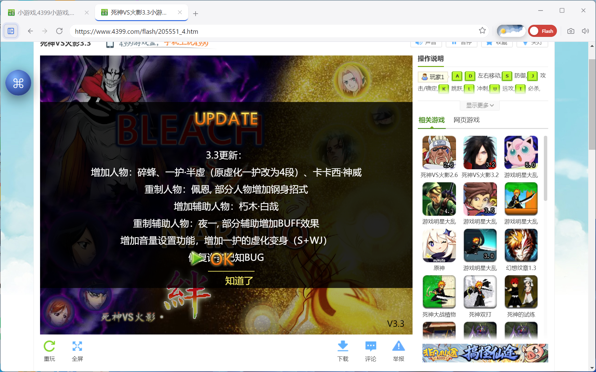
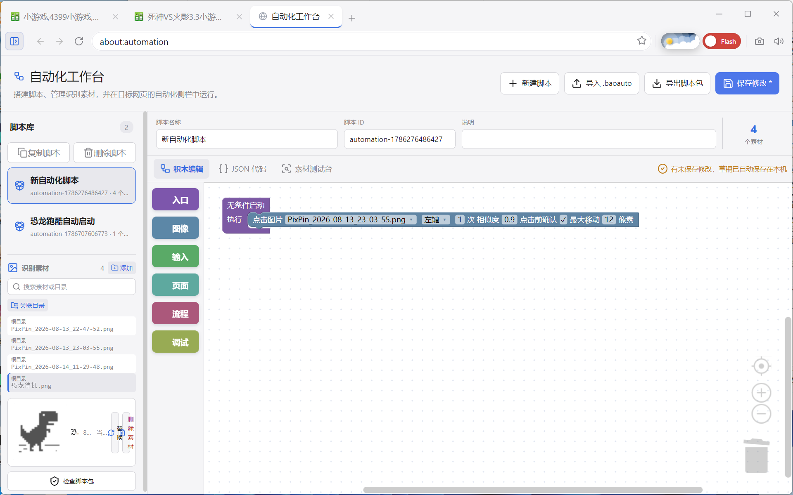
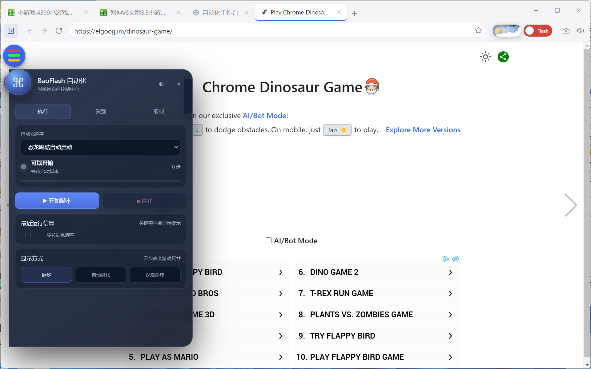
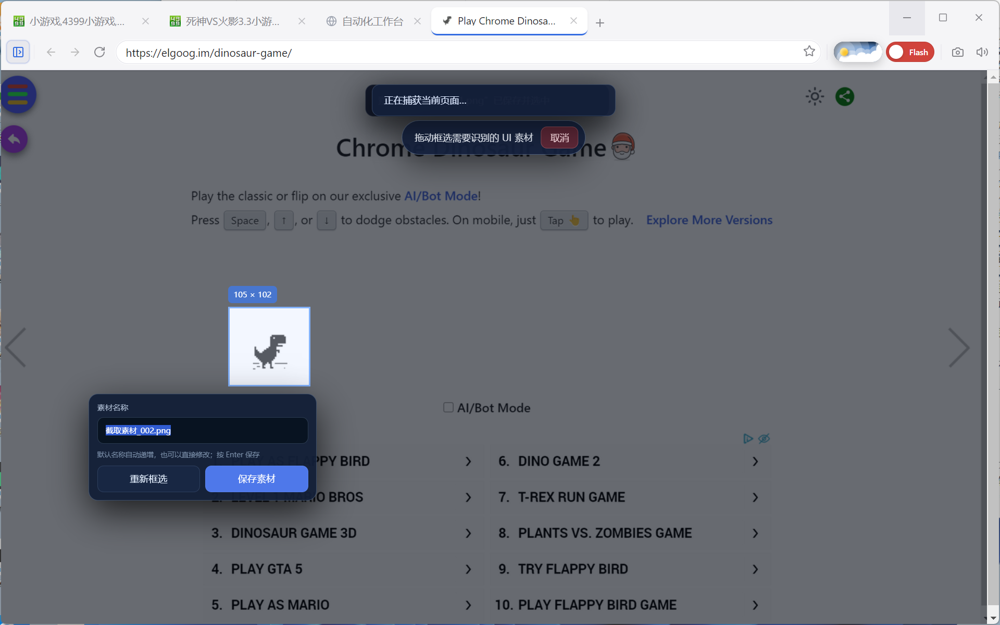
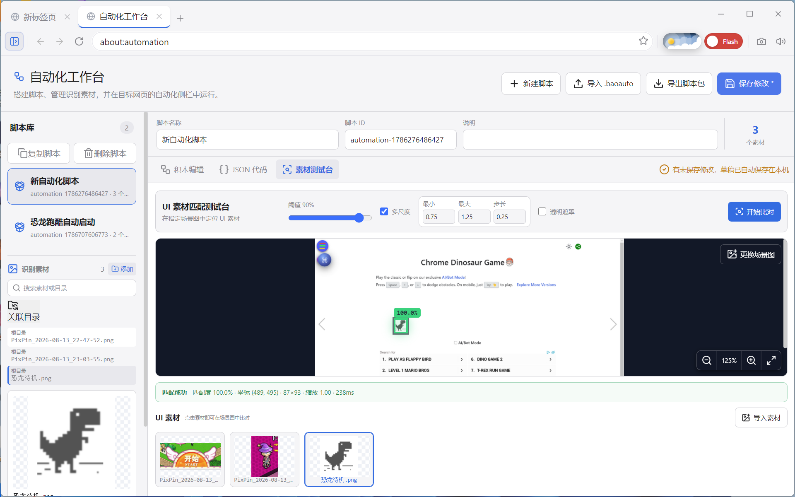

# BaoFlashBrowser

> 让老 Flash 游戏继续运行，也能用图片识别和积木脚本自动操作。

[中文](README.md) **|** [English](README_EN.md)

[](https://github.com/Sutanm/BaoFlashBrowser/actions/workflows/ci.yml)
[](https://www.electronjs.org/)
[](#平台支持)
[](LICENSE)

BaoFlashBrowser 不只是一个 Flash 浏览器。它将 **PPAPI/Ruffle 双引擎**、**可视化自动化工作台**和**用户脚本平台**整合在同一个应用中：既解决现代系统无法直接运行旧 Flash 内容的问题，也让用户可以通过图片素材、积木流程和可信输入自动操作网页或游戏。

> **自动化无需一直占用桌面：窗口最小化后，脚本仍可持续截图、识别 UI，并向 BrowserView 发送鼠标和键盘操作。**



<p align="center"><sub>在现代 Windows 系统中继续访问和运行经典 Flash 游戏</sub></p>

## 自动化平台一览

### 像搭积木一样制作脚本



入口、鼠标操作、键盘与文字、识别与等待、页面、流程与调试积木可以自由组合；图片素材、脚本列表和 JSON 源码集中在同一个工作台中管理。

### 不离开游戏页面即可取材和控制

<table>
  <tr>
    <td width="50%"></td>
    <td width="50%"></td>
  </tr>
  <tr>
    <td align="center">悬浮助手：选脚本、检查就绪、启动、停止并查看进度</td>
    <td align="center">框选取材：冻结当前画面，直接保存单个 UI 素材</td>
  </tr>
</table>

### 先验证识别效果，再运行脚本



素材测试台会给出匹配分数，并在完整场景图上高亮最佳命中区域，方便在执行脚本前调整素材和阈值。

完成验证后可以最小化浏览器，让脚本继续按识别结果执行；目标位置发生变化时会重新定位，不依赖录制时的桌面坐标。

## 为什么选择 BaoFlashBrowser

### Flash 双引擎与旧站兼容

- 固定使用最后支持原生 PPAPI Flash 的 Electron 11.5.0 / Chromium 87，不会为了追随新版 Electron 而丢失 Flash 能力。
- 每个标签页可以独立选择 PPAPI 或 Ruffle；Ruffle 支持内置资源和 CDN 后备来源。
- 针对淘米、4399、7k7k 等旧游戏站处理 Flash 版本检测、SWFObject、跨域资源和登录跳转兼容问题。
- 每个标签页使用独立 BrowserView 渲染进程，一个游戏崩溃不会拖垮全部标签。

### 不依赖固定坐标的视觉自动化

- 使用 BrowserView 截图和 OpenCV 模板匹配寻找 UI，根据识别结果点击，而不是回放录制时的桌面坐标。
- 带透明背景的 PNG 默认自动忽略杂乱背景和半透明边缘；每个识图积木也可切换为强制透明遮罩或完整图片匹配。
- 同一素材子目录可自动组成图片组，在一帧画面中寻找方向图或动画关键帧里得分最高的成员。
- 程序最小化后 BrowserView 仍可渲染，脚本能够继续截图、识别并发送可信鼠标或键盘输入。
- 支持自动定位游戏画面入口、手工游戏区域入口和识图就绪入口；页面坐标与游戏画面坐标可在同一脚本中切换，高速识图区域会继续与当前游戏画面取交集。
- 脚本作者可从悬浮助手复制游戏画面特征串并导入入口积木。运行时会跨多层 iframe 重新寻找对应的 Flash、Ruffle 或 Canvas 画面，窗口大小改变后自动等待并重新定位。
- 支持相对坐标快速点击、区域内随机多击、坐标/图片通用移动与拖拽、组合键、按住直到、文本输入、滚动、跳转和刷新。
- 支持 `if / else`、`all / any / not` 组合条件、等待成功/超时分支、主动结束脚本、固定次数循环、一直重复、跳出当前循环和循环直到条件成立。
- 点击前可再次确认目标并限制位置偏移，降低动画或误识别造成的错误点击。

### 面向普通用户的积木工作台

- 在 `about:automation` 中像 Scratch 一样组合入口、鼠标操作、键盘与文字、图片/OCR 识别与等待、页面、流程和调试积木。
- 同一工作流也可以直接编辑 JSON，积木与 JSON 可相互转换和校验。
- `.baoauto` 脚本包同时保存工作流和图片素材，支持导入、导出、复制、检查和分享。
- 素材测试台可把 UI 素材放到指定场景图中比对，显示分数并高亮最佳匹配区域。

### 游戏页面内的悬浮助手

- 左上角悬浮球展开后即可选择脚本、检查就绪、倒数启动、停止运行并查看当前步骤和日志。
- 无需第三方截图软件，直接冻结当前游戏画面并框选单个 UI 素材。
- 可在页面内调整识别阈值、捕获并比对或连续监测，也可选择游戏画面、复制特征串和获取可直接用于积木的页面/游戏坐标。
- 助手和其他页面浮窗在识图与运行期间保持显示；面板可以收起、拖到另一侧或自动淡化，请由用户把它移出识别和点击区域。

### 完整的用户脚本平台

- 提供油猴风格的脚本管理页、两阶段安装、启用/停用、更新、导入导出和脚本菜单命令。
- 支持受控 GM API、`@require`、值存储、网络请求、下载、通知和 iframe 子框架执行。
- 内置 CSS 修复器可改善 Chromium 87 打开现代网页时的部分样式兼容问题。
- 用户脚本不能直接访问 Node.js、任意 Electron IPC 或本地文件系统。

## 自动化是怎样工作的

| 阶段 | 用户操作 | 平台行为 |
| --- | --- | --- |
| 1. 取材 | 在游戏画面框选按钮、图标或文字 | 保存为当前脚本的 UI 图片素材 |
| 2. 验证 | 在素材测试台或悬浮助手中开始比对 | 计算匹配分数并高亮实际命中区域 |
| 3. 搭建 | 拖入入口、识图、输入和流程积木 | 生成经过结构校验的工作流 |
| 4. 就绪 | 启动脚本并等待前提条件 | 识别到指定页面后提示就绪 |
| 5. 执行 | 立即或倒数启动 | 在 BrowserView 中重新定位并发送可信输入 |

这使脚本可以表达“看到登录按钮才点击”“等待游戏加载完成再按组合键”“满足多个前提后循环操作”等逻辑，而不是只记录一串延时和坐标。

## 适合哪些场景

- 为重复的游戏登录、领取、确认和页面切换制作可复用流程。
- 等待加载标志出现或消失后再执行下一步，避免固定延时在慢机器上失效。
- 按住方向键直到识别到目标画面，或通过组合条件处理不同分支。
- 在浏览器最小化时继续执行不需要人工观察的重复操作。
- 用用户脚本修补网页外壳，再用视觉自动化操作无法通过 DOM 获取的 Flash 内容。

图像自动化不理解业务含义。账号、交易、删除等不可逆操作仍应保留人工确认。

## 快速开始

1. 打开侧边栏中的“自动化”，进入工作台；也可以直接访问 `about:automation`。
2. 新建脚本，在素材区导入图片，或者在目标游戏页展开悬浮助手并选择“取材”。
3. 需要让脚本适应窗口大小时，先在助手中选择游戏画面并复制特征串，再把它导入“自动找到游戏画面后启动”入口；普通网页脚本可直接使用无条件入口。
4. 连接识图、输入、分支或循环等执行积木。
5. 保存修改，先在素材测试台确认高亮位置和相似度。
6. 回到目标游戏页，在悬浮助手中选择脚本并启动。

动图目标应只截取稳定部分。完整操作说明见[自动化脚本使用手册](docs/automation-user-guide.md)。

## 启用实验性 Flash

实验通道用于尚未完全验证的 Flash 插件，不是全局“开发者模式”。开启方法：

1. 打开侧边栏中的“设置”。
2. 进入“Flash / Ruffle”。
3. 将“Flash 插件通道”改为“实验通道”。
4. 点击底部“保存设置”。
5. 完全退出并重新启动 BaoFlashBrowser；只刷新页面或关闭标签页不会生效。

| 平台 | 启用后的行为 |
| --- | --- |
| Windows x64 | 使用随包提供的国内修改版 PPAPI Flash `34.0.0.380` |
| macOS Intel x64 实验包 | 使用随 `.app` 一体化捆绑的 `PepperFlashPlayer.plugin` `34.0.0.380` |
| Windows ia32 / Linux x64 | 暂无匹配的实验插件，请求会回退到稳定插件 |

“伪装版本”是网站看到的版本声明，与实际加载的插件版本不是同一项设置，可以保留默认值。实验插件可能出现组件错误、调试弹窗、崩溃或无法启动；macOS 版本尚未经过任何真实设备测试。切回“稳定通道”同样需要保存并重启。

## 下载

- [GitHub Releases](https://github.com/Sutanm/BaoFlashBrowser/releases)
- [Gitee Releases](https://gitee.com/sutanm/BaoFlashBrowser/releases)
- [v1.1.1 实验性 Flash/macOS 支持说明](docs/experimental-platform-support.md)
- [v1.1.2 发行说明](RELEASE_NOTES.md)

### 1.1.2 正式版安装包

三个正式包均保留全部功能模块，并内置离线 OCR 程序、依赖和中英文模型。换电脑后直接安装对应包，无需下载源码、另装 OCR 或重新编译。

| 平台 | 文件名 | 内置 OCR |
| --- | --- | --- |
| Windows 64 位 | `BaoFlashBrowser-OCR-1.1.2-x64.exe` | Paddle Inference / PP-OCRv3 |
| Windows 32 位 | `BaoFlashBrowser-OCR-1.1.2-ia32.exe` | Tesseract 5.3.0 x86 |
| Linux 64 位 | `BaoFlashBrowser-1.1.2-x86_64.AppImage` | Paddle Inference / PP-OCRv3 |

Win32 的 Tesseract 适合清晰文字和数字，对低分辨率、描边游戏文字的效果弱于 Paddle，详见 [OCR 对比报告](docs/reports/2026-11-02-tesseract-x86-comparison.md)。三个包均包含 OCR，“OCR”文件名不代表裁剪其他模块。macOS 仍为独立实验通道，不在本次正式包中。

Release 同时提供 Windows `.blockmap`、`SHA256SUMS-1.1.2.txt` 和成品校验清单；校验文件对应本次发布的实际安装包。

Windows 安装包当前**未进行代码签名**，安装或首次运行时可能出现 Microsoft Defender SmartScreen 的“未知发布者”提示。请只从项目 Release 页面下载，并核对页面公布的 SHA-256；也可以按照下方步骤从源码运行当前版本。

## 平台支持

| 平台 | 状态 | 说明 |
| --- | --- | --- |
| Windows x64 | 主要支持 | 全模块，包含 PPAPI、aria2、鼠标缩放钩子和 Paddle OCR |
| Windows ia32 | 兼容支持 | 全模块，32 位 PPAPI、aria2 与 Tesseract OCR；已在 32 位 Electron 验证，尚无真实 32 位系统测试 |
| Linux x64 | 有限支持 | 全模块 AppImage 内置 Paddle OCR；运行仍受发行版、FUSE、系统库及 X11/Wayland 影响 |
| macOS Intel x64 | 实验性、零测试 | 一体化捆绑 PPAPI Flash 34.0.0.380；无 Mac 设备测试，Apple Silicon 只能尝试 Rosetta 2 |
| Linux x86 | 不支持 | 缺少完整的 PPAPI 和原生资源支持链 |

## 从源码运行

需要 Node.js 20 和 npm。Electron 固定为 `11.5.0`，请勿升级。

```bash
git clone https://github.com/Sutanm/BaoFlashBrowser.git
cd BaoFlashBrowser
npm ci
npm start
```

### Linux 依赖

Ubuntu/Debian 可先安装 Electron 11 运行所需的图形、音频和系统库：

```bash
sudo apt install -y libnss3 libgtk-3-0 libx11-xcb1 libxtst6 libxss1 \
  libasound2 libdrm2 libgbm1 libxkbcommon0 libpango-1.0-0 libcairo2 \
  libatk1.0-0 libatk-bridge2.0-0 libcups2 libxcomposite1 libxdamage1 \
  libxfixes3 libxrandr2 libxrender1 libxi6 libnotify4 libsecret-1-0 \
  libpulse0 libdbus-1-3 libaria2-0
```

随 Linux 构建提供的 `aria2c` 需要系统存在 `libaria2.so.0`。缺少该库时，程序会尝试系统 `aria2c`，仍不可用则回退到 Chromium 下载引擎。Linux 原生 Wayland 下的鼠标缩放钩子可能不可用，X11、XWayland 和 WSLg 的兼容性更好。

## 构建与验证

```bash
npm run check               # i18n、类型检查、Lint、单元测试和生产构建
npm run test:integration    # OpenCV/OCR 原生集成测试
npm run build:win64         # 全模块 + Paddle OCR，输出 release/ocr/
npm run build:win32         # 全模块 + Tesseract OCR，输出 release/ocr/
npm run build:linux         # 全模块 + Paddle OCR AppImage，在 Linux/WSL 构建
npm run build:win64:standard # 可选：全模块但不携带 OCR 运行时
npm run build:win32:standard # 可选：全模块但不携带 OCR 运行时
npm run build:linux:standard # 可选：全模块但不携带 OCR 运行时
npm run build:mac           # 独立 macOS Intel x64 实验 DMG/ZIP；需 macOS
```

默认启用全部模块；`BAO_MODULES` 是供开发者使用的编译裁剪选项，本次正式包不做模块裁剪。`npm run build` 只生成应用代码，不会生成安装包，也不会自动准备 OCR 运行时。

- **Win64**：首次打包会获取并校验固定版本的 Paddle 运行时和模型。
- **Win32**：需要安装 MSVC C++ x86 工具（Visual Studio / Build Tools）。构建脚本校验仓库内固定版本的 Tesseract 依赖归档，编译原生 x86 BAO1 sidecar；安装包用户无需安装 MSVC 或 .NET。
- **Linux x64**：首次准备 OCR 需 Docker、Git 和 `bsdtar`（Ubuntu/Debian：`sudo apt install libarchive-tools`）。脚本获取固定版本输入，在 manylinux_2_28 容器构建推理程序，再复用本地归档。OCR 包携带所需推理库和模型，校验其 glibc 要求不高于 2.28；图形、FUSE 等系统依赖仍需由发行版提供。
- **macOS**：`build:mac` 校验仓库内实验性 Flash DMG，提取完整插件并捆绑进 `.app`，原 DMG 不进入成品。它未经过真实 Mac 验证，也不作为 1.1.2 稳定制品发布。

各平台打包前后均验证 Ruffle、字体、PPAPI、aria2、鼠标钩子、目标架构和 OCR 资源。运行时 esbuild 按目标架构单独准备，防止在 x64 机器上交叉打包 Win32 时混入错误架构。校验清单写入 `release/manifests/`；CI 默认构建与上传上述三个含 OCR 的正式候选包。详见 [打包与测试管线](docs/modules/09-build-release-test.md)。

## 浏览器基础能力

- 标签管理、地址导航、缩放、静音、全屏、页内查找、历史记录和收藏夹。
- Chromium 与 aria2 双下载引擎，支持暂停、恢复、进度显示和安全路径检查。
- 密码本支持可选自动捕获、锁定状态自动填充、排除网站和主密码保护；自动填充不会提交表单。
- 仅在异常退出后询问是否恢复标签页，正常关闭不会保留待恢复会话。
- 中英文界面、明暗主题、Toast 通知和可选标签休眠。

## 常用快捷键

| 快捷键 | 功能 |
| --- | --- |
| `Ctrl+T` / `Ctrl+W` | 新建 / 关闭标签页 |
| `Ctrl+L` | 聚焦地址栏 |
| `Ctrl+Tab` | 切换标签页 |
| `Ctrl++` / `Ctrl+-` / `Ctrl+0` | 页面缩放 |
| `Ctrl+F` | 页内查找 |
| `F11` / `F12` | 全屏 / 开发者工具 |

## 安全与限制

Electron 11、Chromium 87 和 Adobe Flash Player 均已停止安全更新。本程序只应访问可信的旧游戏站点和本地内容，不建议用于邮箱、支付、网盘、办公系统或其他敏感业务。能由 Ruffle 正常运行的内容应优先使用 Ruffle。

Windows 稳定通道实际使用 Flash 29.0.0.171，Windows x64 实验通道和 macOS 实验包使用 34.0.0.380，Linux 使用 32.0.0.371；网站侧的版本声明可能为兼容旧站点而不同。Flash Player 是专有软件，使用者应自行了解所在地区适用的授权与分发要求。

## 文档

- [自动化零基础指南](docs/automation-blockly-beginner-guide.md)——从拖第一块积木开始，讲清坐标、识别与排错
- [自动化使用手册](docs/automation-user-guide.md)——当前 1.1.2 工作台、积木、JS/TS 与 `.baoauto` v3 的完整说明
- [文档索引与时效说明](docs/README.md)
- [自动化脚本使用手册](docs/automation-user-guide.md)
- [用户脚本使用手册](docs/userscript-user-guide.md)
- [用户脚本开发手册](docs/userscript-developer-guide.md)
- [架构总览](docs/architecture-overview.md)
- [发布、打包与成品校验](docs/PACKAGE.md)
- [测试与回归清单](docs/FINAL_REGRESSION.md)
- [文档索引与故障排查入口](docs/README.md)
- [第三方组件与许可证](THIRD_PARTY_NOTICES.md)

## License

BaoFlashBrowser 源代码采用 [MIT License](LICENSE)。安装包中的 Flash Player、Ruffle、aria2、OpenCV、Blockly 和字体等第三方组件仍受各自许可证和权利声明约束，详见 [THIRD_PARTY_NOTICES.md](THIRD_PARTY_NOTICES.md)。
