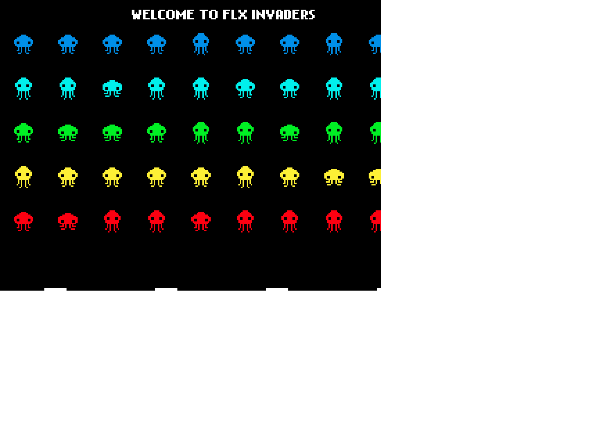

# 高版本 Flash 绝对不是不可能：我在 Chromium 138 上跑通了原生 PPAPI Flash

> 2026-11-14 · 作者：BaoFlashBrowser 项目组
> 结论先行：**Electron 37 / Chromium 138 的内核里，原生 PPAPI Flash 已经能加载、初始化并渲染出真实游戏画面。**
> 不是双内核，不是 Ruffle，不是 CEF 外挂——是同一个 Electron 进程里跑的原生 Flash 插件。



*上图：`FlxInvaders.swf`（68 KB，ActionScript 游戏）在自建的 Electron 37 / Chromium 138 中的实际渲染结果。*

---

## 一、先破除三个"不可能"

这几年关于"高版本内核跑 Flash"，流传最广的三句话是：

1. **"PPAPI 早就删了，138 以后不可能。"**
2. **"Electron/Chrome 官方二进制根本不含插件支持，自编也没用。"**
3. **"命令行注册插件被 Chromium 锁死了。"**

这三句话**分别都对了一半**，但合起来不等于"不可能"。真实情况是：

| 说法 | 真相 |
| --- | --- |
| PPAPI 删了 | **Chromium 140 才删**。139 是最后一个带源码的分支，138（Electron 37）代码完整 |
| 官方二进制不带 | 对。官方构建 `enable_plugins=false`；但**自建可以把 PPAPI 编回来** |
| 注册被锁 | 对，但锁有三道：**MIME 白名单**、**`--allow-command-line-plugins` 开关**、**ppapi 子进程沙箱类型**。三道都能在自建里解开 |

所以真正的问题不是"能不能"，而是"**愿不愿意自建内核 + 补回一层私有接口**"。

---

## 二、我跑通的是什么

| 项 | 值 |
| --- | --- |
| 内核 | Chromium **138.0.7204.35** |
| 外壳 | Electron **v37.0.0**（自建，非官方二进制） |
| Node | v22.16.0 |
| Flash 插件 | 原生 PPAPI `pepflashplayer64`（34.0.0.380） |
| 平台 | Windows 11 x64 |

插件进程的启动日志（自建内核里加了 trace）：

```text
OnLoadPlugin: enter
OnLoadPlugin: library loaded
OnLoadPlugin: got get_interface      ← PPP_GetInterface 调用成功
OnLoadPlugin: calling initialize_module
OnLoadPlugin: init OK                ← PPP_InitializeModule 成功
OnCreateChannel
```

Flash 初始化时会向宿主申请一批**私有接口**，全部拿到：

```text
PPB_Flash_Clipboard;5.1        -> OK
PPB_Flash_File_FileRef;2       -> OK
PPB_Flash_File_ModuleLocal;3   -> OK
PPB_Flash_FontFile;0.2         -> OK
PPB_FlashFullscreen;1.0        -> OK
```

另一个测试页（`button.swf`，一个 1 KB 的按钮动画）：


---

## 三、路径：四道门 + 一层移植

### 第一道门：让 PPAPI 真的编进 Windows 版

`ppapi/buildflags/buildflags.gni` 里写着：

```gn
enable_ppapi = enable_plugins && enable_nacl && !is_fuchsia
```

而 `enable_nacl` 的条件是 `target_os == "chromeos"`——**Windows 上 PPAPI 永远为 false**。
改成：

```gn
enable_ppapi = enable_plugins && !is_fuchsia
```

### 第二道门：命令行插件注册的 MIME 白名单

`content/common/pepper_plugin_list.cc` 只允许测试用 MIME：

```cpp
static constexpr auto kMimeTypeAllowlist = base::MakeFixedFlatSet<std::string_view>({
    "application/x-blink-deprecated-test-plugin",
    "application/x-blink-test-plugin",
    "application/x-ppapi-tests",
});
```

补上 `application/x-shockwave-flash`、`application/futuresplash`。

### 第三道门：必须先打开 `--allow-command-line-plugins`

否则 `ComputePepperPluginList` 根本不会去解析 `--register-pepper-plugins`。

### 第四道门：ppapi 子进程的沙箱类型

`sandbox/policy/sandbox_type.cc` 把 `--type=ppapi` 的映射写成了 `&& !BUILDFLAG(IS_WIN)`，
Windows 上会直接 `NOTREACHED()` → 子进程 `0x80000003` 秒崩。
Windows 分支返回 `Sandbox::kNoSandbox` 即可（PPAPI 在 Windows 本来就不支持沙箱）。

### 然后是真正的工作量：把 Flash 私有层搬回来

Chromium 138 的 `ppapi/` 里**一个 flash 文件都没有**（`c/private`、`proxy`、`thunk` 全空），
但 `PERMISSION_FLASH` 权限位还在。

做法是从 **87 分支**把整套私有层迁回来：

- 9 个 `ppb_flash*.h` 接口头；
- 7 个 `ppapi/proxy/flash_*_resource` + `ppb_flash_message_loop_proxy`；
- 10 个 thunk；
- `ppapi_messages.h` 里约 35 条 Flash IPC 消息；
- `ResourceCreationAPI` / `SingletonResourceID` / RTTI 列表等注册接线。

87 的代码在 138 上会撞上一批 API 漂移，我实际修了 **14 项**，典型如：

| 漂移 | 修法 |
| --- | --- |
| `base/macros.h` 删除 | 去掉 include |
| `DISALLOW_COPY_AND_ASSIGN` 删除 | 改 `= delete` |
| `base::size` / `base::stl_util.h` | 改 `std::size` |
| `base::SupportsWeakPtr` 删除 | 改 `base::WeakPtrFactory` |
| `base::TimeDelta::FromSeconds` | 改 `base::Seconds(...)` |
| `IPC::SyncMessage::EnableMessagePumping` 删除 | 去掉调用 |
| `NOTREACHED()` 变 noreturn | 删掉后面的 `return` |
| `PpapiGlobals::GetCmdLine()` 删除 | 直接读 `--ppapi-flash-args` |

---

## 四、诚实的部分：现在能做什么、不能做什么

**已经可用**：

- Flash 插件加载、初始化；
- 实例创建；
- **渲染、动画、鼠标交互**（游戏画面正常）；
- 多个 SWF 都能跑。

**还没有**（对应日志里的 `Resource host creation failed`）：

| 功能 | 状态 |
| --- | --- |
| 剪贴板读写 | ❌ |
| 代理设置（`GetProxyForURL`） | ❌ |
| 外部链接跳转 | ❌ |
| 全屏 | ⚠️ 接口已注册，宿主未接 |
| LSO 限制 / 无痕策略 | ❌ |

原因：Flash 私有接口在架构上是"**插件进程 → IPC → 浏览器/渲染进程宿主**"。我目前只完成了插件侧，
宿主侧（原来的 `chrome/browser/renderer_host/pepper/*`）还没迁。**但这不影响渲染**——这是我做完之后才确认的。

另外，当前的验证只覆盖了：Windows 上的两个 SWF、单标签、短时间运行。
**长时间播放、多标签、复杂站点（需要 LSO/代理）都还没做回归。**

---

## 五、为什么这件事值得做

现在的 Flash 方案基本三条路：

| 路线 | 优点 | 代价 |
| --- | --- | --- |
| **双内核**（旧 Chromium 87 + 新内核） | 立刻可用 | 两套进程模型、两套书签/密码/下载逻辑、内存翻倍 |
| **Ruffle** | 纯前端、跨平台 | AS3/复杂游戏兼容性有限，原生特性缺失 |
| **CEF 外挂** | 可嵌入 | CEF 官方预编译也不含 PPAPI，仍要自建；还要重写整个外壳 |
| **单内核自建（本文）** | 一个进程模型、一个内核、原生 Flash | 需要自建内核 + 维护一层私有接口移植 |

如果你的目标是"**新内核 + 原生 Flash + 单一内核**"，那自建是唯一的路——而且**它确实走得通**。

---

## 六、成本与建议

| 阶段 | 我实际花的 |
| --- | --- |
| 源码获取（14.4 GB git 缓存，多连接 + 换 IP 绕限速） | 约 1 天（网络受限） |
| 自建带 PPAPI 的 Electron（4 道门 + 工具链坑） | 约半天（含一次 2 小时全量编译） |
| 87 → 138 私有层移植（14 项漂移） | 约 4 小时编译修复循环 |
| 拿到 `init OK` + 出帧 | 当天达成 |

建议：

1. **版本选 138（Electron 37）**：最后一个"源码完整 + 有对应 Electron"的版本；140 起 PPAPI 已删，要复活得整层 vendor；
2. **一次定死 `args.gn`**：改一次开关就是一次全量重编（1–2 小时）；
3. **移植顺序**：先插件侧（能出帧），再按功能补宿主（剪贴板/代理/跳转/全屏）；
4. **别碰共享头文件**：改 `ppapi_messages.h` 一次会触发几千个目标重编。

---

## 七、下一步

- 补宿主层：剪贴板、代理、导航、全屏、LSO；
- 稳定性回归：多 SWF、多标签、长时间播放；
- 把整套补丁整理成可复用的 patch 集，让"高版本 Flash"变成可维护的分支，而不是一次性的实验。

---

## 附：复现

完整的环境、命令、补丁与错误字典见项目内文档：

- 复现手册（AI 版）：`docs/specs/2026-11-14-flash-port-ai-runbook.md`
- 完整历程：`docs/specs/2026-11-14-electron138-flash-port.md`

**一句话总结：高版本 Flash 不是玄学，是四道构建门 + 一层接口移植。它已经被跑通了。**
