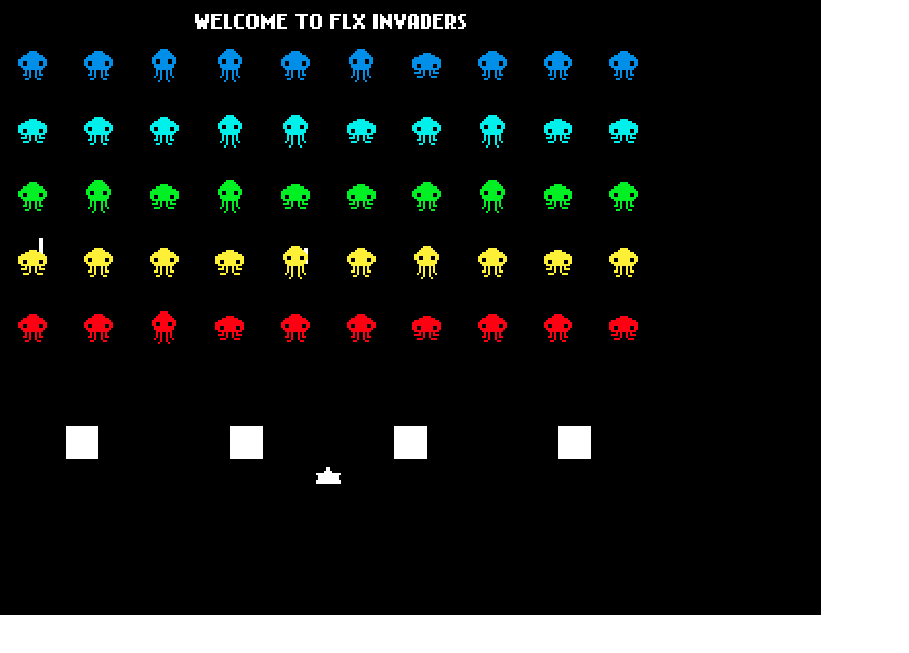

# 从 138 到 140：把原生 PPAPI Flash 再往前推两个大版本

> 2026-11-17 · 作者：BaoFlashBrowser 项目组
> 结论先行：**Chromium 140 / Electron 38 的内核里，原生 PPAPI Flash 已经能加载、初始化并渲染出真实游戏画面。**
> 距离上一篇《高版本 Flash 绝对不是不可能》只过了三天，我们把可行版本从 138 推到 140——又跨了两个 Chromium 大版本。



*上图：`FlxInvaders.swf`（68 KB，ActionScript 游戏）在自建的 Electron 38 / Chromium 140 中的实际渲染结果。*

---

## 一、为什么是 140

138 是**最后一个原生 PPAPI 版本**，这是我们早就确认过的事实。但"最后一个"不等于"只能停在它"。

140 的特殊之处在于：它**删得很凶，但没有删到根上**。

- `ppapi/` 整目录没了（1470 个文件）；
- `content/renderer/pepper/`、`content/browser/renderer_host/pepper/`、`content/ppapi_plugin/` 全没了；
- Flash 专用的 51 个 PPAPI 接口文件也没了；
- **但** `IPC::SyncChannel` / `ChannelMojo` / 消息序列化骨架还在，Blink 的插件 API 也一直没动。

换句话说：**房子拆了，地基还在。** 而 144 才是真的"地基被挖走"——legacy IPC 的消息系统整体移除，`ipc_message_macros.h` 这类东西直接不存在了。所以我们把 140 定为靶子。

---

## 二、这次要跨过的不是"一道门"，是"一条链"

138 那次，卡点是一道道可以数清的"门"：编译开关、MIME 白名单、`--allow-command-line-plugins`、沙箱子进程。

140 这次不一样。真正难的是：**同一个功能，被拆成十几个环节，每个环节都可能静默失败。**

我们把整条链走了一遍，每一环都是实测打通的：

```
浏览器注册 3 个插件          ✅  registered plugins: 3
渲染进程拿到插件列表        ✅  GetPlugins -> all=3
Blink 创建 plugin           ✅  CreatePlugin mime=application/x-shockwave-flash
插件进程启动                ✅  --type=ppapi 存活
插件进程加载 DLL            ✅  entry points get_interface=1 init_module=1
Flash 初始化                ✅  initialize_module returned 0
实例创建                    ✅  instance Create ok
视图下发                    ✅  DidChangeView rect=550x420 clip=550x420
Graphics2D 创建             ✅  2d Init size=825x630（550x420 × 150% DPI）
绘制消息                    ✅  SetScale → ReplaceContents → Flush
合成器出图                  ✅  PrepareTransferableResource
真实画面                    ✅  FlxInvaders 完整渲染
```

值得一提的是 `1143`：在一次 50 秒的启动里，插件进程和渲染进程之间跑了 1143 条 legacy IPC 消息。也就是说——**这条老渠道是真的活的**，不是"勉强没崩"。

---

## 三、两个"一行级"的坑，各花了一个下午

### 坑一：`std::move` 之后又用了一次

渲染进程崩溃，`CHECK failed: shared_image`，栈顶在 `PepperGraphics2DHost::PrepareTransferableResource`。

原因不在 140 的 API 变化本身，而在**调用点的所有权顺序**：

```cpp
// 138 的写法：先取出 mailbox，再把 shared_image move 进回调
gpu::Mailbox mailbox = shared_image->mailbox();
*release_callback = ... std::move(shared_image);
*transferable_resource = viz::TransferableResource::MakeGpu(mailbox, ...);
```

140 把 `MakeGpu(mailbox…)` 合并成了 `Make(shared_image…)`。于是同一个 `shared_image` 在"已经被 move 走"之后又被传进去——拿到空指针，`CHECK` 触发。

修法只有一行：**在 move 之前留一份**。

```cpp
scoped_refptr<gpu::ClientSharedImage> resource_image = shared_image;
*release_callback = ... std::move(shared_image);
*transferable_resource = viz::TransferableResource::Make(resource_image, ...);
```

> 教训：迁移 API 时，**参数语义的变化**比签名变化危险得多。签名会报编译错误，语义不会。

### 坑二：Flash 只画了第一帧，然后就不动了

修完崩溃之后，链路全绿，但截图永远是白的。

我们按"0xFFFFFFFF 到底是谁写的"做了三组实验：

| 实验 | 结果 | 结论 |
| --- | --- | --- |
| E2：Init 后立刻采样 | `0`（透明黑） | 白不是我方初始化写的 |
| E1：Init 后填绿，Flush 后采样 | 白 | 采样到的不是填绿那块 |
| 带指针身份的复测 | Flash 交上来的 buffer 全 `0xFFFFFFFF`，`nonwhite=0` | **Flash 确实写了白** |

顺着这条线，我们把"内容有没有加载"也排掉了：URLLoader 明确收到 `bytes_total=1031`、`received=1031`——正好是 `button.swf` 的字节数；`HandleInputEvent` 也收到了 6 个事件；`PPB_Graphics3D` 一次都没创建。

**内容加载了、输入通了、视图是对的，那 Flash 为什么只画一帧？**

答案是：**它在等一个 ack。**

140 删掉了 Blink 的 `WebLocalFrameClient::DidCommitAndDrawCompositorFrame`。138 里，这个回调会遍历所有活跃的 pepper 实例，调用 `ViewInitiatedPaint()`，后者发出 `PpapiPluginMsg_Graphics2D_FlushAck`——Flash 收到 ack 才会画下一帧。

这个回调消失之后：**第一帧=清屏白，然后永远等下去。**

我们把 ack 临时提前到"资源交给合成器"的那一刻，画面立刻出来了：

```
修复前：位图 nonwhite=0，三次截图 digest 完全相同，interactiveFrames=1
修复后：位图 nonwhite=110137，三次 digest 各不相同，interactiveFrames=3
```

---

## 四、还有一个"版本"的坑

画面出来后，我们换了 `FlxInvaders` 再测：结果弹出一个 Flash 自带的对话框——**"当前版本不再受支持"**。

一开始以为是移植问题，后来确认是**国内魔改版 34.0.0.380 的时间炸弹**。

换成项目自带的 **29.0.0.171** 之后：游戏完整渲染，没有 EOL 提示。

| 插件 | 结果 |
| --- | --- |
| `pepflashplayer64.dll`（29.0.0.171） | ✅ 完整渲染游戏 |
| `pepflashplayer64_34_0_0_380.dll`（魔改） | ⚠️ 能初始化、能出图，但 EOL 时间炸弹会弹窗 |

**结论：把 29 作为默认，34 魔改版只作兼容性备选。** 这条经验值不少——如果一开始就只用 34 测试，我们可能会把时间炸弹误判成移植 bug，白查很久。

---

## 五、诚实的部分

现在能做什么：

- ✅ 网页里的 `<embed type="application/x-shockwave-flash">` 正常创建实例并渲染
- ✅ 逐帧刷新（游戏能动、鼠标有反馈）
- ✅ 2D 内容（游戏、动画、按钮）全部走通

现在还不能做什么：

- ⚠️ **Stage3D**：140 删了 `SetDefaultFramebufferSharedImage`，我们的 3D 绑定降级成 no-op（只影响 3D 游戏）
- ⚠️ **Flash 视频**：`CopyVideoFrameToSharedImage` 换成 `ClientSharedImage` 语义，帧拷贝暂时跳过
- ⚠️ **`PPB_WebSocket`**：目前是桩
- ⚠️ **`FlushAck` 时机**：当前是"资源交付时发"，终态应该是"帧呈现后发"（用 140 的 `InsertVisualStateRequest`）

---

## 六、成本

| 项 | 数值 |
| --- | --- |
| 从 138 搬运的文件 | **1662** 个（ppapi 1470 + pepper 宿主 203 …） |
| 手工改动 | **63** 个文件 |
| 新增的 Flash 私有 PPAPI | **51** 个文件 + 8 处接线 |
| 总耗时 | **约 2.2 天 / 18–20 工时** |
| 崩溃次数（有记录的） | 9 次，其中 7 次是"链路里某一环静默缺失" |

对比当初对 140 的估算（2–4 周）：**实际快了约 10 倍**。原因不是我们变强了，而是那次可行性评估把"哪里会疼"提前标了出来——真正花时间的不是写代码，是**在 1143 条消息里找到停住的那一条**。

---

## 七、为什么还要往前走

有人会问：138 已经能跑了，为什么折腾 140？

一个朴素的理由：**每往前一个大版本，就有更多现代网站能正常打开。** TLS、字体、CSS、JS 引擎，都是随版本走的。Flash 是历史遗产，但外壳不应该被历史拖住。

另一个更私人的理由：这次移植让我确信——**被删掉的东西，往往不是"一个功能"，而是一整条通知链。** 复活它的过程，就是把这根链条上一节一节的环找回来。找齐了，它自己就开始转了。

`FlxInvaders` 的欢迎语重新出现在 Chromium 140 的窗口里那一刻，还挺浪漫的。

---

## 附件

- 可行性/历程全记录：[`specs/2026-11-15-forward-version-feasibility.md`](../specs/2026-11-15-forward-version-feasibility.md)（§1.14.11 是最终状态）
- **面向 AI 的 140 复现手册**：[`specs/2026-11-17-chromium140-ppapi-revival-ai-guide.md`](../specs/2026-11-17-chromium140-ppapi-revival-ai-guide.md)（含 25 条错误字典）
- 上一篇（138）：[`2026-11-14-high-version-flash-is-possible.md`](2026-11-14-high-version-flash-is-possible.md)
