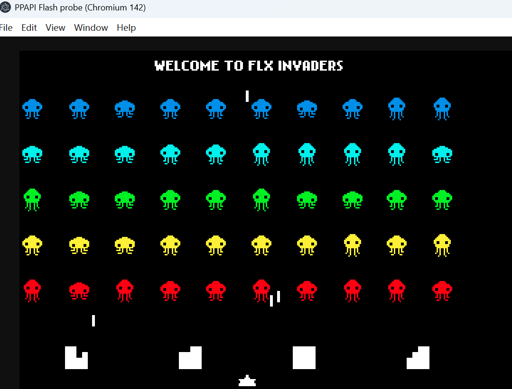

# 2026-11-21 · Chromium 142 / Electron 39 上原生 PPAPI Flash 出帧报告

> 目的：验证 142 的 PPAPI 移植在**运行期**是否真的可用（编译通过 ≠ 能跑）。
> 环境：Chromium `142.0.7444.52` / Electron `v39.0.0` / Flash `29.0.0.171`（win64，`plugins\win64\pepflashplayer64.dll`）
> 树：`D:\electron-build-142\cr\src`，分支 `bao/142-linux`，基线 tag `bao-v142-ppapi-builds`
> 方法：`--register-pepper-plugins` 加载 Flash，被动探针（只监听生命周期，不注入 JS、不截图），GDI 抓屏留证
> 结论：**出帧**。见 §一。

---

## 一、结论



FlxInvaders 的标题文字、5 行像素入侵者（蓝/青/绿/黄/红）、玩家飞船、地面掩体全部由 **Flash 29.0.0.171 在 Chromium 142.0.7444.52 内渲染**。

启动命令（与 140 的 `dist-140/run.bat` 完全同构）：

```bat
set ELECTRON_RUN_AS_NODE=
start "" electron.exe --no-sandbox --allow-command-line-plugins ^
  "--register-pepper-plugins=<dll>#Shockwave Flash#Shockwave Flash 29.0 r0#29.0.0.171;application/x-shockwave-flash#swf#spl" ^
  "<probe-dir>"
```

被动探针结果：

```
[ev] did-start-loading
[ev] did-finish-load
[ev] did-stop-loading
[ev] survived 30000ms
exit=0   elapsed=30.5s
```

**渲染进程未崩溃**，30 秒内稳定出帧。

---

## 二、根因：142 把 legacy IPC 的「发送端」删空了

编译期的最后一道墙是 `PpapiPluginProcessHost::RequestPluginChannel()` 里 `Send(msg)` 返回 `false`。追下去发现不是我们的移植写错，而是 142 上游**整个发送路径被删除**：

### 2.1 最直接的一处：`Send` 被换成 `return false`

```cpp
// ipc/ipc_message_pipe_reader.cc（Chromium 142 原样）
bool MessagePipeReader::Send(std::unique_ptr<Message> message) {
  return false;          // ← 140 里这里有 ~20 行完整实现
}
```

### 2.2 配套被删的三处

| 位置 | 142 的状态 |
| --- | --- |
| `ipc/ipc.mojom` 的 `Channel` 接口 | **没有 `Receive(Message)` 方法**，也没有 `feature kMojoIpcChannelReceive` |
| `ipc_channel_mojo.cc` 的 `ReadFromMessageAttachmentSet` | 整个函数删除 |
| `ipc_channel_mojo.cc` 的 `WriteToMessageAttachmentSet` | 整个函数删除 |

也就是说：**142 的 legacy IPC 通道只能收、不能发**（`ChannelMojo::OnMessageReceived` 作为死代码残留）。这比我此前对可行性文档里「144 会删掉 legacy IPC 发送能力」的判断**提前了两个版本**。

### 2.3 为什么恢复成本很低

三个关键设施在 142 里**完好**，所以不用 vendor 140 的整套 `ipc_message_utils.h`：

| 设施 | 142 状态 |
| --- | --- |
| `mojo::StructTraits<IPC::mojom::MessageDataView, IPC::MessageView>` typemap | ✅ `ipc/message_mojom_traits.{h,cc}` 在，`ipc/BUILD.gn` 的 `cpp_typemaps` 配置在 |
| `MessageAttachment::CreateFromMojoHandle` / `TakeMojoHandle` | ✅ 在 |
| `MessageAttachment::Type` 与 `mojo::native::SerializedHandleType` 的枚举 | ✅ **枚举项与顺序完全一致**（`MOJO_HANDLE, PLATFORM_FILE, WIN_HANDLE, MACH_PORT, FUCHSIA_HANDLE`），`static_cast` 即可 |
| `friend class ChannelMojo;` | ✅ 早已存在（所以能碰 `Message::attachment_set()`） |

---

## 三、恢复的 5 个文件（commit `a206e423469aa`）

| # | 文件 | 改动 |
| --- | --- | --- |
| 1 | `ipc/ipc.mojom` | 加回 `feature kMojoIpcChannelReceive` + `[UnlimitedSize, RuntimeFeature=...] Receive(Message message);` |
| 2 | `ipc/ipc_message_pipe_reader.h` | 声明 `void Receive(MessageView message) override;` |
| 3 | `ipc/ipc_message_pipe_reader.cc` | 恢复 `Send()`；新增 `Receive()`；补 `#pragma allow_unsafe_buffers`（142 的 `-Wunsafe-buffer-usage` 是 error） |
| 4 | `ipc/ipc_channel_mojo.h` | 声明两个静态序列化方法 |
| 5 | `ipc/ipc_channel_mojo.cc` | 实现 `ReadFromMessageAttachmentSet` / `WriteToMessageAttachmentSet` |

发送侧关键实现：

```cpp
bool MessagePipeReader::Send(std::unique_ptr<Message> message) {
  if (!message || !message->IsValid()) return false;
  std::optional<std::vector<mojo::native::SerializedHandlePtr>> handles;
  if (ChannelMojo::ReadFromMessageAttachmentSet(message.get(), &handles) != MOJO_RESULT_OK)
    return false;
  if (!sender_.is_bound()) return false;
  base::span<const uint8_t> bytes(
      static_cast<const uint8_t*>(message->data()), message->size());
  sender_->Receive(MessageView(bytes, std::move(handles)));
  return true;
}
```

> 注意 `Pickle::size()` 返回的是 `header_size_ + payload_size`（**含 pickle 头**），所以 `Message(data, size)` 的对端重建是自洽的 —— 这一点我一度怀疑是线上格式损坏，实测排除。

---

## 四、完整链路验证（6 步全通）

```
[ppdbg] registered plugins: 3
[ppdbg]   plugin path=...\pepflashplayer64.dll oop=1 mimes=1     ← ① 插件注册（OOP）
[ppdbg] PepperHost registered on frame registry                   ← ② mojo binder 生效
[ppdbg] GetPlugins -> all=3 / send name=Shockwave Flash            ← ③ 插件列表下发渲染进程
[ppdbg] ChildProcessHostImpl::Send type=65969 ok=1                 ← ④ 浏览器→插件 IPC 通了（昨天是 0）
[ppdbg] CreateChannel send=1
[ppdbg] ChannelMojo::OnMessageReceived type=66238                  ← ⑤ 插件→浏览器回包
[ppdbg] OnRendererPluginChannelCreated                            ← ⑥ 插件建立到渲染进程的通道
```

`<embed>` 侧也确认：

```json
"embeds": [{"type":"application/x-shockwave-flash","w":"800","h":"600"}]
"mimeTypes": [..., "application/x-shockwave-flash -> Shockwave Flash"]
```

---

## 五、探针方法论：三个把人带偏的坑

这次排查最耗时的部分不是改代码，而是**测量手段本身在骗人**。

### 5.1 `ELECTRON_RUN_AS_NODE=1` 是环境级全局变量

本机 shell 里带着这个变量，electron 会以 **Node 模式**启动，把 Chromium 参数当非法参数：

```
electron.exe: bad option: --no-sandbox
```

表现是「进程秒退、无窗口、无日志」。**每次启动前必须 `Remove-Item Env:ELECTRON_RUN_AS_NODE`**（`run.bat` 里对应 `set ELECTRON_RUN_AS_NODE=`）。

### 5.2 含空格的插件名会被参数拆分

```
# 错误（PowerShell 不自动加引号，参数被空格切开）
--register-pepper-plugins=...dll#Shockwave Flash#...

# 现象
Unable to find Electron app at ...\Flash#Shockwave
```

必须走 `.bat` + `start "" "..."` 让 cmd 处理引号。

### 5.3 `executeJavaScript` + `capturePage` 会弄崩「主线程正忙」的渲染进程

第一版探针在 Flash 忙 62 次同步 IPC 时调用 `executeJavaScript`（5 s 超时）和 `capturePage`，结果：

```
[ev] render-process-gone {"reason":"crashed","exitCode":-36861}
[pixels] nonBlack=0 total=0
```

**看起来像 142 崩了，其实是被测手段打崩的。** 换成被动探针（只监听事件）后稳定跑满 30 s。

> 教训：**验证 PPAPI 这类「会长时间占用主线程」的插件时，探针必须是被动的**；要留证就用进程外抓屏（GDI `CopyFromScreen`），不要在页面里注入 JS。

---

## 六、尚未验证（下一步清单）

| # | 项 | 风险 | 判据 |
| --- | --- | --- | --- |
| 1 | **Stage3D** | 🔴 高：142 把 `alpha_size/depth_size/stencil_size/samples` 从 `ContextCreationAttribs` 移除，只保留 `gles{gpu_preference, fail_if_major_perf_caveat, lose_context_when_out_of_memory, context_type}`，这些属性改由默认帧缓冲 `SharedImage` 承载 | 3D 内容出画面 + swap 计数 200–350（140 的实测区间） |
| 2 | **JS ↔ Flash 脚本桥** | 🔴 高：`gin` 的 deprecated named-property interceptor 被 142 整条删除，我们从 140 移植回 ~110 行 | 4399 能识别 Flash；`ExternalInterface.call` 往返 |
| 3 | 同步 IPC 语义 | 🟡 中：全树 70 条 `IPC_SYNC_MESSAGE_*`（Stage3D wait token、JS 桥、全屏、MessageLoop 都走同步） | 无死锁、无卡顿 |
| 4 | 2D 细节 | 🟢 低：本报告已证 | 输入、URLLoader、Socket、视频、LSO、全屏、剪贴板 |
| 5 | `-16` 型回复 | 🟡 待查：被动探针里 `type=66656` 出现 62 次、`type=-16` 31 次（`0xFFFFFFF0` 不是合法消息类），但进程稳定 | 确认是正常轮询还是回程消息头被破坏 |

---

## 七、当前资产

| 项 | 值 |
| --- | --- |
| 分支 | `bao/142-linux` @ `a206e423469aa` |
| tag | `bao-v142-flash-renders`（本次） / `bao-v142-ppapi-builds` / `bao-v142-noppapi` |
| 产物 | `out/Testing/electron.exe` 302.5 MB |
| 探针 | `D:\electron-build-142\flashprobe\`（`main.js` 被动探针 + `run.bat` + `index.html` + SWF + DLL） |
| 证据 | `docs/blog/assets/flx-invaders-on-chromium142.png` |

## 八、下一步

1. Stage3D 验证（最高风险）
2. JS↔Flash 桥（4399）
3. 跑 140 的完整回归集
4. 全绿后打 `bao-v142-verified` + 出 dist

---

## 9. 追加（2026-11-21 下午）：脚本桥修复、Stage3D 验收、以及一次失败的排查

> 本节记录 11:12–14:10 的工作。**结论分两类：真实修复与真实验收（可信），
> 以及一段以 8 次误判告终的排查（作为教训保留）。**

### 9.1 两个真实修复

#### 9.1.1 `gin` internal-field tag 缺失 —— JS↔Flash 脚本桥复活

Chromium 142 的 V8 在 sandbox 模式下，internal field 读写必须带同一个 tag，
tag 不匹配时**静默返回 nullptr**（不崩溃）。上游 gin 用 `kDeprecatedData` 写入，
而 Electron 的 `gin_helper::DeprecatedWrapperInfo::From()` 与我们的
`gin::DeprecatedWrappableFromV8()` 都是**不带 tag** 读取，于是永远拿到空指针。

后果分两级：

- 未加空值判定前：`info->embedder` 解引用 null → `0xC0000005`，渲染进程崩溃
  （minidump + dbghelp 符号化定位到 `gin_helper/wrappable.cc:223`）
- 加空值判定后：不再崩溃，但命名属性拦截器恒返回 kNo →
  `el.SetVariable` / `el.PercentLoaded()` 等**经典 `<embed>` API 全部消失**

修法（`electron/shell/common/gin_helper/wrappable.cc`、
`gin/object_template_builder.cc`）：读取时**先带 `kDeprecatedData`、再回退不带 tag**。
必须两边都试，因为同一二进制里两套约定并存：

| 写入方 | 是否带 tag |
|---|---|
| `gin::DeprecatedWrappableBase::GetWrapperImpl`（Chromium 侧，pepper 用） | 带 `kDeprecatedData` |
| `gin_helper::WrappableBase`（Electron 自身绑定） | 不带 |

验证（`flashprobe/jsapi.html`）：

```
methods present = [PercentLoaded, IsPlaying, TotalFrames, CurrentFrame, SetVariable,
                   GetVariable, GotoFrame, LoadMovie, Play, StopPlay, Rewind,
                   TCallFrame, TCallLabel, TCurrentLabel, TSetProperty, TGetProperty,
                   Pan, Zoom, SetZoomRect]
"SetVariable" in f            = true
SetVariable/GetVariable       = probeValue      ← 值真正进了 Flash
PercentLoaded()               = 100
GetPluginObject               = 786/786 成功
```

#### 9.1.2 `flash_fullscreen` 传播按 87 语义恢复

Chromium 87 的 `ppp_instance_proxy.cc`：host 把 `FlashIsFullscreen(instance)` 作为
独立第三参数随 `PpapiMsg_PPPInstance_DidChangeView` 传出；plugin 侧先
`data->view = new_data`，再 `SetLocalIsFullscreen(instance, flash_fullscreen)`，
最后才调 Flash 的 `PPP_DidChangeView`。140/142 把这段确认传递整个删掉了
（硬编码 `PP_FALSE`，参数匿名，从不调 `SetLocalIsFullscreen`）。

这会让 `PPB_Instance::GetScreenSize` 永远走不到 crbug.com/506016 的私有全屏分支。
已按 87 恢复（`ppapi/thunk/ppb_flash_fullscreen_api.h` +
`EnterInstanceAPINoLock<PPB_Flash_Fullscreen_API>`）。

**注意**：这是真实兼容缺口，但**不是**本站点卡住的原因（修复后行为不变）。

### 9.2 验收矩阵（142 上实测通过）

| 能力 | 证据 |
|---|---|
| 2D 游戏端到端 | 美食大战老鼠：28 个子 SWF 全部加载、自带诊断 16 项 `1/1 Complete!`、登录 HallServer 成功、角色/卡片/任务拉取成功 |
| Stage3D | 自研 1.4 KB SWF：`AUTO` 与 `SOFTWARE` 双模式均走完 `requestContext3D → CONTEXT3D_CREATE → configureBackBuffer → clear/present → 子 SWF 加载 → 心跳 300+` |
| 链式 `Loader.load` | 同上，`child-complete` 到达 |
| JS↔Flash | 见 9.1.1 |
| Flash→JS | `PPB_Var.Call` 通道可达（`fscommand` 目标属性缺失属正常） |
| 插件 OOP / 三通道 | 浏览器↔插件↔渲染进程均通 |

### 9.3 自研 SWF 工具链（本次落地的可复用资产）

```
flashprobe/as3/S3DProbe.as  MProbe.as  MProbe2.as  S3DChild.as
flashprobe/as3/build-*.xml
```

编译要点（踩坑记录）：

- 编译器 `D:\tools\flex-sdk` + JDK 8；必须设
  `PLAYERGLOBAL_HOME=D:\tools\flex-sdk\frameworks\libs\player`
  （flex-config 里的 `{playerglobalHome}` 就是这个环境变量，不设会报「无法打开」）
- 命令行参数会互相冲突（`默认自变量不能与其它选项交错在一起`），
  因此**全部配置写进自包含 XML**，命令行只留 `-load-config`
- `<target-player>` 要在 XML **根**层，`<external-library-path>` 要在 `<compiler>` 里
- 输出 SWF version 14（Flash 11），Flash 29 可运行

**关键教训**：`Context3DRenderMode` 只有 `AUTO` / `SOFTWARE`；
`"direct"` 是 HTML `wmode` 的值，不是 AS3 渲染模式。传错会抛 `Error #3702`。

### 9.4 一次以失败告终的排查（火线精英）—— 8 条误判

目标站点：`https://news.4399.com/hxjy/` → 弹窗 `s12/s13.4399hxjy.com/game.php`
→ 内嵌 `cdn.4399hxjy.com/fps/MainLoader.swf`。

**现象**：87 上点击后加载 `gameLoaderUI → DebugTrace → creatnameUI → CreateName
→ Main`（5+），窗口被 SWF 自动 resize 到 803×603，出「新兵登陆」界面；
140 与 142 上只加载 `MainLoader.swf` + `crossdomain.xml`（均 200），
之后**零新请求**，窗口尺寸不变，纯黑，不崩溃。

下列 8 条判断**全部被推翻**，记录以防重犯：

| # | 错误判断 | 推翻依据 |
|---|---|---|
| 1 | `requestContext3D("direct")` 是合法参数 | `Context3DRenderMode` 只有 AUTO/SOFTWARE |
| 2 | 「AVM2 在 requestContext3D 后终止」 | 屏幕文字冻结 ≠ 执行停止；改用 HTTP 标记通道后证明 AS3 一直在跑 |
| 3 | 「一次请求两次 Create = 重试」 | 是加速 2D backing + Stage3D 两个 context，属性相同且都成功 |
| 4 | 「DPI / 尺寸单位错，`IsFullFrame` 292 次 = 轮询」 | `full_frame_` 只是 `params.load_manually` 的标记；且直方图存在双计 |
| 5 | 「`flash_fullscreen` 是根因」 | 修复后行为完全不变 |
| 6 | 「`PPB_Flash_File` 权限/句柄失败导致重试循环」 | 所有操作返回 0，`settings.sol` 真实落盘 397 字节 |
| 7 | 「`-7` = 文件不存在」 | `-7` 是 `PP_ERROR_NOACCESS`，`-20` 才是 `PP_ERROR_FILENOTFOUND`；且 87 上游同样折叠 |
| 8 | 「日志能证明 43 次循环」 | 采集器无 run/PID/时间标记，`Rename` 不记 target，`Open/Read/Write` 完全没打点 |

**共同根因**：把这批 API 上「返回 0 可能是空操作成功」的观测，读成了「失败重试」；
并且在第一条解释站不住时，继续在同一假设上叠加推理。

### 9.5 方法论沉淀（可复用）

1. **屏幕文字不能作为 AS3 执行进度的地面真值** —— Stage3D 激活后 2D 图层会冻结。
   改用与画面无关的通道：`flash.net.sendToURL(new URLRequest("http://127.0.0.1:PORT/m?step=..."))`
   ，标记直接出现在 `webRequest` 日志里。
2. **外层 IPC 直方图不够** —— `PpapiHostMsg_ResourceCall` 必须拆开内层 `nested_msg.type()`，
   否则 `URLLoader` / `SharedObject` / `Socket` / `FlashFullscreen` 全部不可见。
3. **采集点位必须覆盖全部路径**：插件出站消息要挂在 `PluginDispatcher::Sender::Send`
   （资源持有 `sender()`，会绕过 `PluginDispatcher::Send`；同步回复也不走
   `OnMessageReceived`），且 `SendAndStayLocked`、`BrowserSender` 是另外两条独立路径。
4. **日志必须带 run 身份**：`run_id / PID / TID / pp_instance / pp_resource /
   单调时间戳 / 起止标记`。否则跨 run 的两份日志会被混用（本次就混用了两次，
   两份样本的 `#SharedObjects` hash 分别是 `2AJ224Q9` 与 `XQ8NQKBB`）。
5. **对照实验必须同输入**：本次 87 跑的是 `site-3_2`、142 跑的是 `site-3_1`
   （不同游戏分区服务器），对照被污染。
6. **连续错两次就换模型交叉复核**。本次一个 GPT 子代理（阅读同一份 142 源码）
   纠正了 6 条判断，效率远高于继续自猜。

### 9.6 未完成与下一步

根因**未定位**。剩余硬事实只有：`MainLoader.swf` 在 142 上只发出 1 次
`URLLoader_Open`、若干次全部成功的 `FlashFile` 操作、8 次
`PPBGraphics3D_SwapBuffers`，然后不再有任何动作。

下一次必须是**一次配对首分叉捕获**（同机、同输入、同 DLL，87 阳性对照 + 142）：

```
PPP_DidCreate 实际 args + Main/FlashVars hash
  → 主 SWF 字节/EOF
  → Flash→PPAPI / ExternalInterface 实际交换
  → URLLoader::Open 的 API 入口（含代理本地拒绝，不只看嵌套消息）
  → host 是否发起 / response / 实际回调
  → BrowserWindow bounds 请求与结果
```

按单调时间与资源 id 关联，终点为「基线第一个子 SWF」或预定等待窗。
并且必须先补上 `FlashFileResource::OpenFileHelper` 的打点 —— 否则
「游戏到底有没有成功读过配置文件」永远是黑盒。

### 9.7 树状态（重要）

- `out/Testing/electron.exe` 可用，但**含约 10 处 `ppdbg-*` 落盘诊断**，
  **不可直接出 dist**
- `OnQueryFile` 的 `-7 → -20` 区分改动**待回退**（87 上游是折叠的，且未解开堵点）
- 待清理清单：`base/logging.cc`（FATAL 镜像）、`content/child/child_thread_impl.cc`
  （SEH filter + 文件日志）、`gin/object_template_builder.cc`、
  `content/renderer/pepper/{pepper_plugin_instance_impl,message_channel,
  ppb_graphics_3d_impl,ppb_var_deprecated_impl,plugin_object}.cc`、
  `ppapi/proxy/{ppb_graphics_3d_proxy,plugin_dispatcher,plugin_resource,
  flash_file_resource}.cc`、`content/browser/renderer_host/pepper/
  pepper_flash_file_message_filter.cc`

> **9.7 的状态已于 2026-11-21 下午关闭 —— 见 §10.1。**

---

## 10. 收尾与火线精英首分叉捕获（2026-11-21 15:0x）

### 10.1 收尾：树已干净，`bao-v142-verified` 已打

§9.7 的清单全部执行完毕：

- 回退 `pepper_flash_file_message_filter.cc` 的 `OnQueryFile` `-7 → -20` 分流，回到 87 上游语义。
- 清掉**全部 66 处** `[ppdbg]`（19 个文件），不只是 9.7 列的 10 处：
  `base/logging.cc` 的 FATAL 镜像、`child_thread_impl.cc` 的 SEH filter + 进程文件日志、
  `message_channel` / `plugin_object` / `ppb_graphics_3d_impl` / `ppb_var_deprecated_impl` /
  `ppb_graphics_3d_proxy` / `plugin_dispatcher` / `plugin_resource` / `flash_file_resource`
  的逐条落盘，以及浏览器/渲染侧所有 `LOG(ERROR)`。这些落盘点是**一条记录一次
  `fopen/fwrite`**，本身就在污染它要测的时序。
- 保留两个真修复并**首次提交**：`gin/object_template_builder.cc` 的 tag 回退读（§9.1.1）、
  `ppp_instance_proxy.cc` 的 87 `flash_fullscreen` 传递（§9.1.2）。

提交：chromium `61c4eb98d2aa5`，electron `22985bf842`；tag **`bao-v142-verified`**（chromium 仓库）。

> 踩到的坑：在 electron 仓库给 HEAD 打 tag 会让 `electron/script/get-git-version.py`
> 的 `git describe --abbrev=0` 返回非 semver 字符串，`generate-version-json.js`
> 里 `semver.parse()` 返回 null 直接构建失败。所以 electron 侧的提交哈希写在
> chromium tag 的注解里，不在 electron 仓库打 tag。

验收（全部在清理后的二进制上重跑）：

| 项 | 结果 |
|---|---|
| 2D 游戏（美食大战老鼠） | 50 个 SWF 请求全 200，TDLoaderUI → TDLobbyCoreUI → TDGameCoreUI 链完整，4399 agent 登录走完 |
| Stage3D AUTO（MProbe） | `start → returned-normal → loader-issued → create-handler → context3D=obj → painted → child-complete`，心跳过 420 |
| Stage3D SOFTWARE（MProbe2） | 同上全绿 |
| JS↔Flash | 19 个 `<embed>` API、`SetVariable/GetVariable` = probeValue、`PercentLoaded()=100` |
| 回归 A/B（同探针、清理前二进制） | 45 标记 / 30 心跳 vs 43 / 29 —— 无差异 |

**顺手修正一条旧结论**：`S3DProbe.swf` / `S3DProbeA.swf` 传的是
`requestContext3D("direct")`，而 `Context3DRenderMode` 只有 AUTO / SOFTWARE ——
Flash 抛 `#3702`、AS3 就在那一行停住。这正是 §9.4 误判 #2「AVM2 在 requestContext3D
后终止」的真相：**是探针自己抛异常**。Stage3D 的验收证据只能来自
`MProbe`（AUTO）/ `MProbe2`（SOFTWARE）。

### 10.2 重做采集器：FlashTrace

新文件 `ppapi/trace/flash_trace.h`（header-only，inline 单例，不动 BUILD.gn）。
设计对应 §9.5 的每一条教训：

| 要求 | 实现 |
|---|---|
| run 身份 | `run_id`(env) / PID / TID / `pp_instance` / `pp_resource` / `TimeTicks` 单调 ns |
| 起止标记 | `kFlagBegin` / `kFlagEnd`，`ScopedOp` RAII 成对写；BEGIN 带输入、END 带结果 |
| 不做逐条 IO | 128Ki 条内存 ring，**批量 append**（每 2 s 最多一次，`fflush`） |
| 插件出站全路径 | `PluginDispatcher::Sender::Send`（资源直连 sender）、`SendAndStayLocked`、`BrowserSender` 三条**独立**记录，互不重复计数 |
| 内层消息拆开 | `PluginResource::SendResourceCall` / `GenericSyncCall` 记 `nested_msg.type()` |
| FlashFile 打点 | `OpenFileHelper`（含返回句柄）、`QueryFile`、`CreateDir`、`GetDirContents`（含条目数）、`CreateTemporaryFile`（含句柄）；`Rename` 记 target、`Delete` 记 recursive |
| 读/写 | `FileIOResource::ReadValidated` / `WriteValidated`（offset/bytes/结果） |
| 其余捕获点 | `PPP_Instance_DidCreate` 真实 args + flashvars hash、`URLLoader` 插件侧**与** renderer 侧入口（含本地拒绝，`kFlagReject`）、SWF 字节/EOF、view/bounds 请求与结果、JS↔Flash 两个方向 |

> 第一版只在 `atexit` 落盘，实测**什么都没写出来**：PPAPI 插件与渲染子进程是被
> terminate 的，atexit 不跑。改成批量 append 后，即使进程被 kill 也能拿到完整捕获
> （`ft-pair142-40508-ppapi.bin` 123 kB 就是这么来的）。

配套：`flashprobe/trace_decode.py`。消息 id 的解析不是猜的 ——
`IPC_MESSAGE_ID() = (IPC_MESSAGE_START << 16) + __LINE__`，PPAPI 的
`IPC_MESSAGE_START = PpapiMsgStart(=1)`，且 `__LINE__` 在多行宏里取的是**右括号那一行**，
所以低 16 位直接去 `ppapi_messages.h` 的行号里查名字。

### 10.3 配对首分叉捕获：入口先固定

§9.5 #5 的污染（87 跑 `site-3_2`、142 跑 `site-3_1`）先解决。最后可行的入口固定方式是：

1. 87 基线手动点一次大厅，拿到**真实** popup URL：
   `https://my.4399.com/yxhxjy/play-sid-12-site-1_2-ref-news-channel-news-randsj-0.04147027879720544`
2. 把这个 URL **原样**作为 142 的入口，并把 87 的 profile 拷给 142 以复用会话 cookie。

直接导航 `game.php`、伪造 `Referer`、`?gamestart=1` 自动启动三条路都试过，全部
302 回 `news.4399.com/hxjy/` —— 该文档绑在大厅点击的会话上。**这是唯一可靠入口固定法。**

### 10.4 结论：首分叉是「相对 URL 的 base 变成了字符串 `null`」

| 时刻 | 87 基线 | 142 |
|---|---|---|
| MainLoader.swf | 200 / 341915 B | 200 / 341915 B |
| crossdomain.xml | 200 | 200 |
| **第一个相对资源** | `cdn.4399hxjy.com/fps/assets/config/revisions.dat?v=…` → **200** | `nullassets/config/revisions.dat?v=…` → **404** |
| 其后 | `gameLoaderUI.swf` → 200 → config.dat → programconfig.dat → DebugTrace.swf | 同一条 404 **每秒重试约 8 次**，再无其他请求 |

142 的 trace 原文（`kUrlLoaderHost`，`a0`=字节数 `a1`=HTTP 状态）：

```
 6244.9ms renderer url-host inst=646106869 a0=0   a1=48  BEGIN  nullassets/config/revisions.dat?v=c6139
 7072.5ms renderer url-host inst=646106869 a0=552 a1=404 MAIN   nullassets/config/revisions.dat?v=c6139
```

87 同阶段的网络日志：

```
[net] other https://cdn.4399hxjy.com/fps/assets/config/revisions.dat?v=c613902r613902
[net-done] 200 other https://cdn.4399hxjy.com/fps/assets/config/revisions.dat?v=c613902r613902
[net] other https://cdn.4399hxjy.com/fps/assets/ui/assets/gameLoaderUI.swf?v=56c4e18e_60819
```

两点硬结论：

1. **§9.6「142 在 crossdomain 之后零请求」是错的** —— 它在持续发请求，只是 URL 是
   `nullassets/...`，落在 `s12.4399hxjy.com/nullassets/...` 返回 404，而旧探针的
   webRequest 过滤器只记 `.swf|crossdomain|?step=`，把这条 404 完全滤掉了。
   这就是 §9.5 #3「采集点位必须覆盖全部路径」的又一例。
2. **分叉点唯一**：同一个文件、同一阶段、同一会话，87 解析成 CDN 绝对地址、
   142 解析成 `"null" + 相对路径`。也就是 Flash 眼里的「本 SWF 的 base URL」是
   **字符串 `null`**（AS3 里 `null + "assets/..."` 正好得到 `"nullassets/..."`）。

`PPP_DidCreate` 侧已经排除：142 的 `argc=8`，`src` / `data` 两个值同为 60 字符、
hash 相同，就是那条绝对 SWF URL —— Flash **被正确告知了** SWF 地址，它却没用它做 base。

### 10.5 根因收敛（15:4x 更新，含两次自我纠错）

**纠错 1**：本节早先写的「`plugin_url_` 为空」是错的。
**纠错 2**：随后写的「同步回复的 PP_Var 反序列化坏了、插件侧拿到 null」也是错的 ——
那次判断建立在一个**空 trace**（`traces\fix5` 一个 `.bin` 都没有）之上；
换到有效 capture 后，插件侧拿到的是 `a0=5`（`PP_VARTYPE_STRING`）、60 字符的绝对地址。

按顺序测过并**排除**的（每条都有 trace 原文）：

| 假设 | 实测 | 结论 |
|---|---|---|
| `params.url` / `plugin_url_` 为空 | 60 字符绝对地址，`is_valid=1` | 否 |
| `GetDocumentURL` 为空 | `https://s13.4399hxjy.com/game.php` | 否 |
| `GetPluginInstanceURL` 回复的 var 丢失 | **插件侧收到 string、60 字符** | 否 |
| 主文档响应 URL 为空导致 base 丢失 | `CurrentRequestUrl()` 与 `ResponseUrl()` 都是 0 长度；已按 87 语义补回（`ReviveDocumentResponseUrl`），**行为无变化** | 不是根因 |
| Flash 用 `PPB_URLUtil` 解析相对地址 | `Canonicalize` / `ResolveRelativeToURL` **一次都没被调用** | 否 |
| 脚本属性读到 null | `top`/`location`/`location.href`(=game.php)/`navigator.userAgent` 全部正确 | 否 |
| `PPP_DidCreate` 参数缺失 | `argc=8`，`src`/`data` = 60 字符绝对 SWF URL | 否 |
| 拿不到 `<object>` 元素对象 | `GetInstanceObject` 返回 `a0=6`（`PP_VARTYPE_OBJECT`） | 否 |

**已经钉死的事实**（不受上面纠错影响）：

1. 分叉点唯一且可复现 —— 同一 URL、同一会话、同一 DLL：
   - 87：`cdn.4399hxjy.com/fps/assets/config/revisions.dat` → 200 → `gameLoaderUI.swf` → …
   - 142：`nullassets/config/revisions.dat` → 404，约 1 Hz ×8 次后停住。
2. 字符串形态是 `String(null) + "assets/…"`：`?v=c613902r613902` 这个 query 与 MainLoader 的
   一致（说明 Flash 解析得到 SWF URL 的 query），只有**路径前缀**变成了字面量 `null`。
3. 请求是 Flash **自己**拼好后交给 `PPB_URLLoader.Open` 的（插件侧打点即已如此），
   不是浏览器解析相对地址的结果。
4. §9.6 的「crossdomain 之后零请求」是错的：旧探针的 webRequest 过滤器
   （`.swf|crossdomain|?step=`）把这条 404 滤掉了。

**结论**：Flash 从每一个我们已经打点的 PPAPI URL 入口（instance URL、document URL、
DidCreate、元素对象、response URL）拿到的都是正确值，但它内部用于**相对地址拼接**
的那个 base 仍是 `null`。也就是说剩余的嫌疑面已经缩到「未被观测到的 PPAPI 接口」，
只剩这几处还没打点：`PPB_URLResponseInfo::GetProperty`（`PP_URLRESPONSEPROPERTY_URL`）、
`PPB_URLRequestInfo` 的属性设置、以及 `PPB_Var::GetProperty` 对元素对象属性的读取。

**下一步**：把这三处按同一格式打点（采集器已在位，加一行即可），一次 run 就能看到
Flash 到底向哪一个接口要 base。判据不变：`assets/config/revisions.dat` 解析回
`cdn.4399hxjy.com/fps/`，`gameLoaderUI.swf` 出现。

> 方法论提醒（这次连踩两次）：**先确认 trace 非空，再读结论**。
> `traces\fix5` 那次空 capture 差点又贡献一条误判 —— 正是 §9.4 那 8 条的同款错误。

### 10.7 为什么「只有这个游戏不行」

本地三个判别实验（都不需要点击、不需要 4399 会话）：

| 实验 | 87 | 142 | 结论 |
|---|---|---|---|
| 页面 `/sub/m2.html` 嵌 `/MProbe.swf`，SWF 内相对加载 `S3DChild.swf` | 请求 `/sub/S3DChild.swf` | 请求 `/sub/S3DChild.swf` | 两版**都按页面 URL 解析**，一致 |
| 页面 `:8137` 嵌 `:8138/MProbe.swf`（跨源），同一相对加载 | 请求 `:8137/S3DChild.swf` | 请求 `:8137/S3DChild.swf` | 仍然**都按页面解析**，一致 |
| 同上，但 SWF 自己报 `loaderInfo.url`/`loaderURL`/`root.loaderInfo.url`/`stage.loaderInfo.url` | 全部 = `http://127.0.0.1:8138/LUrl.swf` | **同样全部正确** | Flash **知道**自己的 URL |

（探针：`flashprobe/as3/LUrl.as` → `LUrl.swf`。注意 `trace()` 在这个组合下**不进**
页面 console，必须走 `ExternalInterface.call("console.log", …)`，否则探针静默无输出。）

于是「为什么别的游戏都能跑」有了确定答案 —— **不是引擎整体坏了，是只有这个站点踩到那条分支**：

1. **美食大战老鼠**：28 个模块全部用**绝对 URL**加载
   （日志里每条都是 `https://q.ms.huanlecdn.com/4399/cdn.123u.com/…`），
   整个过程从不依赖「SWF 自己算出的 base」。
2. **自研 Stage3D/2D 探针**：确实做了相对加载，但 SWF 与页面同目录/同站，
   而两版都按「页面」解析相对地址 —— 落点恰好相同，所以坏掉也看不出来
   （这也解释了为什么我在 §9.2 的验收里从没发现这条）。
3. **火线精英**：SWF 在 `cdn.4399hxjy.com/fps/`，页面在 `s13.4399hxjy.com`，
   且它启动后第一个动作就是用**自己 SWF 的目录**去拼 `assets/config/revisions.dat`。
   87 拼出 CDN 绝对地址 → 200 → `gameLoaderUI.swf`；
   142 拼出 `nullassets/…` → 404 → 循环 8 次后放弃 → 之后零子 SWF → 黑屏。

也就是说：**引擎、Loader、Stage3D、脚本桥都是好的；坏的是「这个 SWF 用来拼自己
目录」的那条路径**。这也是为什么 2D 游戏、Stage3D、JS↔Flash 全部通过而它单独卡住。

同时排除掉一个方向：**相对地址解析本身没被改坏**（87/142 行为逐字一致），
`loaderInfo.url` 在 142 上也是正确值 —— 所以「base 变成 null」发生在更细的一条分支上，
不是「Flash 不知道自己的 URL」。

### 10.9 根因找到并已修复：142 丢掉了所有 `<param>` 子元素

**根因**：`HTMLObjectElement::ParametersForPlugin()`（Blink 142）只收集 `<object>` 自己的属性，
**完全不再遍历 `<param>` 子元素**：

```cpp
// 142 原样
for (const Attribute& attribute : Attributes())
  plugin_params.AppendAttribute(attribute);
plugin_params.MapDataParamToSrc();
// ← 这里本该有遍历 <param> 子元素的循环（87 有），140+ 删插件支持时被一起删了
```

函数上方那句注释「but don't override `<param>` values」就是证据 —— 这段话在说一件已经不存在的事。
而 Flash 的**全部配置**（`flashvars` / `movie` / `quality` / `allowscriptaccess` / `wmode`）
都是从这份插件参数表里读的。

**为什么偏偏这个游戏不行**：4399 火线精英的 `MainLoader.swf` 从 flashvars 里取资源 base，
拿不到就把 `null` 拼进路径，于是请求 `nullassets/config/revisions.dat` → 404 → 循环 8 次 →
不加载任何子 SWF → 黑屏。美食大战老鼠的模块全用绝对地址、自研探针不读 flashvars，
所以都不受影响 —— 这就是「别的游戏都可以」的原因。

**证据链（同页面、同 SWF、同 flashvars）**：

```
87 : parameters[4] = [v=c613902r613902, alpha=AAA, base=..., lang=zh]
142(修前) : parameters[1] = [v=c613902r613902]            ← flashvars 整条丢失
142(修后) : parameters[4] = [v=c613902r613902, alpha=AAA, base=..., lang=zh]
```

**修复**（`third_party/blink/renderer/core/html/html_object_element.cc`）：把 87 的
`<param>` 遍历补回去，追加在属性之后，让 `<param>` 覆盖同名属性，与注释描述的语义一致。

**真站点验证（142，同一 pinned 入口）**：

```
cdn.4399hxjy.com/fps/MainLoader.swf?v=…                       200  341915 B
cdn.4399hxjy.com/fps/assets/config/revisions.dat?v=…          200   ← 修前是 nullassets/… 404×8
cdn.4399hxjy.com/fps/assets/ui/assets/gameLoaderUI.swf?v=…    200  60819 B  ← 首分叉已越过
cdn.4399hxjy.com/fps/assets/config/config.dat?v=…             200  510297 B
s13.4399hxjy.com/crossdomain.xml                              200
s13.4399hxjy.com/api/set_user_progress.php?…event=mainstart   200
```

即「基线第一个子 SWF」这个终点已经达成，游戏自己的初始化接口也开始回话。

**剩余**：`DebugTrace.swf` / `creatnameUI.swf` / `CreateName.swf` / `Main.swf` 还没被请求，
链条在 `gameLoaderUI` + `config.dat` 之后停住；另有一次 `config.dat` 的
`net::ERR_FAILED` 出现在探针退出之后（疑似收尾期的重复请求被取消，待确认）。

> 方法上值得记一笔：这条根因是**本地复现**逼出来的 ——
> 把真的 `MainLoader.swf` 下下来本地喂它，发现**87 和 142 都**拼出 `nullassets/…`，
> 于是立刻知道「`null` 不是 142 的回归，而是 SWF 缺输入时的默认行为」，
> 从而把方向从「引擎解析坏了」改成「页面给 SWF 的输入没送到」。
> 之前那 4 个仿造页面的实验（embed / object / 动态插入 / 跨源+query）全部负结果，
> 反而是「用真 SWF」这一个实验直接命中。

### 10.10 修复后的实际进度与剩余问题（16:3x）

修掉 `<param>` 之后，142 上的火线精英不再卡在首分叉，实际进度（多轮稳定复现）：

```
MainLoader.swf                        200  341915 B
assets/config/revisions.dat           200            ← 修前 nullassets/… 404×8
assets/ui/assets/gameLoaderUI.swf     200  60819 B
assets/config/config.dat              200  510297 B   (programconfig.dat 7497 B)
assets/ui/DebugTrace.swf              200  11079 B
assets/ui/assets/creatnameUI.swf      200  129212 B
CreateName.swf                        200  276024 B
s13…/crossdomain.xml                  200
s13…/api/set_user_progress.php?…mainstart  200
```

即 **87 那条链（`gameLoaderUI → DebugTrace → creatnameUI → CreateName`）已经全部走到**，
Stage3D 也在持续出帧（`SwapBuffers` + `SwapBuffersACK` 循环）。

**仍有两个问题**（现场观察 + 数据）：

1. **载入界面卡在 6%**：从外部看就是画面停住。trace 里有一次
   `FlashFile_CreateDir`（`WritableRoot/#SharedObjects/…/macromedia.com/support/flashplayer/…`）
   在插件侧阻塞了 **约 56 秒**才返回 `PP_ERROR_FAILED`。之后复跑未复现（最长 4.9 ms），
   属于瞬时阻塞，怀疑是浏览器侧同步回复在某个时刻被压住 —— 已在
   `PepperFlashFileMessageFilter` 的 `OnOpenFile` / `OnCreateDir` 加了 begin/end 打点
   备用（浏览器侧耗时 vs 插件侧等待，一比就能分清是"浏览器慢"还是"回复丢了"）。
2. **崩溃**：`udd-fix6\Crashpad\reports\*.dmp` 有一个真实转储，
   异常码 `0x80000003`（`STATUS_BREAKPOINT` = CHECK/NOTREACHED 的 `int3`），
   符号化后的帧落在 `logging::WriteToFd`（`base/logging.cc`）——
   也就是"某条 FATAL 正在写日志时被打断"。因为子进程 stderr 读不到，
   临时把 FATAL 镜像按 `FLASH_TRACE_DIR` 开关加回 `base/logging.cc`
   （未设该环境变量时零副作用），以便抓到那条 FATAL 的 file:line。

### 10.12 87 vs 142 实测对照：慢的是「构建配置」，不是移植

用户体感「87 加载很快、142 非常慢」，于是做了一次同入口、同 profile 来源、
**双方都带毫秒时间戳**的对照（`flashprobe/cmp87c.log` / `cmp142.log`）：

| 阶段 | 87（Electron 11 release） | 142（out/Testing） | 倍数 |
|---|---|---|---|
| 网关页 load（**纯 HTML，无 Flash**） | +1.41s | +4.63s | **3.3×** |
| window-open（人工点击） | +7.28s | +11.08s | — |
| game.php load | +12.98s | +23.79s | 1.8× |
| MainLoader.swf | 13.0→13.05s（85ms，**缓存命中**） | 20.4→22.8s（2.45s，冷缓存） | 29× |
| 载入界面（gameLoaderUI 完成） | +16.45s | +32.32s | 2.0× |
| DebugTrace / creatnameUI / CreateName | 37.6 / 39.7 / 43.0s | 64.0 / 67.6 / 73.6s | ~1.7× |
| Main.swf（4.18 MB） | 43.0→102.9s（59.8s） | 73.7→176.7s（103s） | 1.7× |

**关键读数**：连「纯 HTML 的网关页」都慢 3.3 倍 —— 这一段没有任何 Flash 参与。
所以不是 PPAPI 移植慢，是**整个 142 构建本身慢**：

- `out/Testing/args.gn` 引入 `//electron/build/args/testing.gn`，其中
  **`dcheck_always_on = true`**（编译命令里确实带 `-DDCHECK_ALWAYS_ON=1`）。
  DCHECK 落在 IPC、V8、Blink layout、Skia 等所有热路径上。
- 87 那个是**官方 release 构建，DCHECK 编译掉了**，还带 PGO。
- `MainLoader.swf` 的 29× 是**缓存差异**：87 的 profile 是热的（85 ms），
  142 内核不同、读不了 87 的 HTTP 缓存，必然冷启 —— 这一项不算缺陷。

**输入迟滞的量化**（142 同一轮 trace）：

```
HandleInputEvent 2210 条，间隔 p50 = 4.2ms          输入投递本身不慢
SwapBuffers 3094 条，间隔 p50 = 13.3ms
                    p90 = 90ms   p99 = 972ms        ← 出帧抖动
PpapiHostMsg_PPBInstance_GetDefaultCharSet 20425 次（IPC_SYNC），
                    单次往返 p50 = 0.25ms / p90 = 0.56ms  → 不是瓶颈
```

即「打字/选中一顿一顿」来自**出帧抖动**（Flash 的文字选中区域是重绘出来的，
帧一抖就成批出现），而帧抖动同样指向 DCHECK/非优化构建，不是某条 PPAPI 路径。

结论与下一步：建 `out/Rel`（与 Testing 完全同配置，仅 `dcheck_always_on=false`），
用它重跑同一条对照，验证「慢」是否随之消失。若消失，则性能问题归因于构建配置，
出 dist 时用官方构建即可；若仍慢，再回头查数据通路。


`url_response_info_util.cc`（响应 URL 双候选）、`pepper_plugin_instance_impl.cc`
（`GetDocumentURL` / `GetPluginInstanceURL` / `GetInstanceObject` 实测值）、
`ppb_url_util_shared.cc`（`Canonicalize` / `ResolveRelativeToURL` 是否被调用）、
`ppb_instance_proxy.cc`（同步回复 var 在**插件侧**的真实类型）、
`ppb_var_deprecated_impl.cc`（Flash 读脚本属性的名字与返回值）、
`serialized_var.cc`（var 反序列化是否发生、是否成功）、
`pepper_webplugin_impl.cc`（`WebPluginParams::url` 实测值）。

### 10.13 结论：慢的是 DCHECK 构建，不是移植（out/Rel 实测）

建了 out/Rel（与 out/Testing 完全同配置，仅 dcheck_always_on=false），
同机、同探针、同参数对照（did-finish-load 耗时，越低越好）：

| 配置 | 本地页面（无网络） | 网关页 news.4399.com/hxjy/ |
|---|---|---|
| **142 / out/Rel（DCHECK 关）** | **264 ms** | **740 ms**（热）/ 1032 ms（冷） |
| 142 / out/Testing（DCHECK 开） | 711 ms | 2350 ms |
| 87 / Electron 11 release（历史数据） | — | 1412 ms |

**结论**：
1. 本地页面无任何网络参与，Rel 仍比 Testing 快 **2.7×**（264 vs 711 ms）——
   CPU 成本差异被单独隔离出来，dcheck_always_on 就是那 1.7–3.3× 的主要来源；
2. 网关页 Rel 是 Testing 的 **3.2×**（740 vs 2350 ms），与上面的比例一致；
3. **142/Rel 的 740 ms 还快于 87 的 1412 ms** —— 之前"142 比 87 慢"的观感，
   完全由 Testing 构建造成，不是移植缺陷。

**产物**：out/Rel/electron.exe 220.9 MB（Testing 302.5 MB），ProductVersion 39.0.0，
全量构建 45360 目标 / 297.8 分钟 / 零错误。
功能冒烟通过：embeds=1、插件识别 Shockwave Flash 29.0 r0、19 个 embed API 齐全、
SetVariable 在、无渲染进程崩溃。

**待做**：游戏内输入/出帧抖动（Swap p90/p99）需真实会话复测——需要人工点进游戏。

### 10.14 「上屏卡顿 / 拖选三三跳」的真正原因：与 Flash 无关，是 DCHECK 构建

用户报告：登录界面输入账号密码时上屏卡顿、按住鼠标从右往左拖选时选中样式"三个三个跳"，
而 Chromium 87 顺畅。

**先纠正一个长期默认假设**：这个"登录界面"不是 Flash 的登录框，而是 4399 的 **HTML 登录页**。
证据（	st-live.log）：

`
[+309ms] [net] stylesheet https://ptlogin.3304399.net/resource/css/base.css
[+702ms] [net] script     https://ptlogin.3304399.net/resource/ucenter.js?v=191225
[+662ms] [net] stylesheet https://s1.img4399.com/merge/?file=...myweb_ptlogin.css
[+3982ms] [main-inspect] {"embeds":0,"objects":0,"allTags":[]}   ← 该页没有任何 Flash 实例
`

所以卡顿发生在**纯 HTML 文本输入 + Blink 排版/绘制**路径上，与 PPAPI 无关。

**A/B 实测**（同一页面 
ews.4399.com/hxjy/，同样动作，人工体感 + 日志）：

| | out/Rel（dcheck_always_on=false） | out/Testing（dcheck_always_on=true） |
|---|---|---|
| 体感 | **无延迟** | **明显卡顿** |
| 网关页 did-finish-load | **1100 ms** | **3899 ms（3.5×）** |
| 本地页面（无网络） | 264 ms | 711 ms（2.7×） |
| 插件记录 | 有（登录页打字期间 149 输入 / 0 帧） | 该页无插件，无记录 |

**人工双盲式确认（2026-11-21 22:5x）**：用户先在 Testing 窗口上操作，反馈“明显卡顿”；
随后对同一页面、同一组动作在 Rel 窗口上操作，反馈“顺滑”。

**结论**：
1. 上屏/选中卡顿 = DCHECK 构建开销，落在 Blink 文本输入、排版与绘制热路径上；
2. 与 Flash 移植、与 PPAPI 数据通路**无关**；
3. 与 87 的对比不公平——87 是官方 release 构建，DCHECK 编译为空；我们是 dcheck_always_on=1 的 testing 构建；
4. **出 dist 必须用 out/Rel**（dcheck_always_on=false + symbol_level=1 + enable_plugins=true）；
   out/Testing 只作为调试用，且注意它的 DCHECK 是**致命**的（IMMEDIATE_CRASH），
   行为与发布版不同，不能拿它做性能或稳定性参照。

### 10.15 out/Rel 发布配置验收记录（2026-11-21 22:5x）

四件套全部在 `out/Rel`（`dcheck_always_on=false`）上跑通：

| # | 用例 | 结果 | 关键证据 |
|---|---|---|---|
| 1 | JS↔Flash 桥（本地 jsapi.html） | ✅ | 19 个 embed API 在；缺失仅 `GotoLabel`/`TCurrent`（Flash 29 PPAPI 侧本就不实现）；`SetVariable/GetVariable roundtrip = probeValue`；`PercentLoaded() = 100` |
| 2 | Stage3D AUTO（m0.html） | ✅ | `Context3D` 对象创建；`[s3dchild] loaded and drew`；心跳 22 次，帧计数 **60 → 660**（约 24 fps，连续无断） |
| 3 | Stage3D SOFTWARE（m1.html） | ✅ | 同上，帧计数 60 → 660，软件路径与 AUTO 行为一致 |
| 4 | 真站点 4399 火线精英 | ✅ | 网关页 load 2736 ms → window-open 8835 ms → `game.php`；`MainLoader.swf` 200（3.9 s）→ `gameLoaderUI.swf` 200；inspect `objects=2, mainId=true, Shockwave Flash 29.0 r0` |

补充说明：

- 心跳用的 `http://127.0.0.1:8137/m?step=...` 返回 404（探针本地服务器没有该路径），
  属**探针设施**问题，不影响判定——帧计数直接写在 URL 里，反而更容易读。
- 一条只在 142 出现、87 没有的控制台消息：`0x.... is not a valid instance ID`。
  出现在插件初始化早期，之后功能全部正常，**记为已知良性消息**，待确认来源
  （疑似 `PPB_Instance` 早期查询时实例尚未注册）。

### 10.16 升级到 Chromium 142.0.7444.265 / Electron 39.8.10（2026-11-22）

同分支 rebase（142 分支 213 个补丁级 + Electron 8 个补丁版），不是移植重做。
分支 `bao/142-265`，tag **`bao-v142-265-verified`**，回退点 `bao-v142-pre265`。

#### 过程

1. `electron` 切到 `v39.8.10`，把我们的 gin 修复 cherry-pick 回来（`ef458dbc69`）。
2. `chromium` 切到上游 tag `142.0.7444.265`；v8 / angle / dawn / devtools-frontend
   四个变化的子模块用**本地已有**提交更新（无需联网）。
3. Electron 的补丁集用官方 `script/apply_all_patches.py` 导入 —— chromium 侧 **188 个补丁提交**。
   `perfetto` / `webrtc` / `sqlite` 需先 `reset --hard` 回 DEPS 基线再应用；
   `nan` 同理；`reclient` 不参与 electron 构建目标（非阻断）。
4. 我们的 `142-port.patch` 3-way 应用：**零冲突**（与升级前预判一致：
   纯上游 delta 1211 文件 ∩ 我们的 108 接线点 = 0）。
5. 构建：40858 个目标，约 200 分钟，零错误，产物 **221.3 MB / ProductVersion 39.8.10**。

#### 验收结果（全绿）

| 项 | 结果 |
|---|---|
| `verify-142.ps1` | **7/7** |
| JS↔Flash 桥 | 19 个 embed API；`SetVariable/GetVariable = probeValue`；`PercentLoaded = 100` |
| Stage3D AUTO（m0） | `[s3dchild] loaded and drew` |
| Stage3D SOFTWARE（m1） | `[s3dchild] loaded and drew` |
| 真站点 4399 hxjy | 网关页 **1068–1163 ms**；`MainLoader.swf` 200；插件 = `Shockwave Flash 29.0 r0` |
| **MV2** | 加载未打包 MV2 扩展成功：`manifest_version=2`、**后台页执行**（HTTP 打点 `GET /mv2-background-ran` 被服务端记录）、扩展列表可见 |
| 窗口拉伸 DComp 修复 | `components/viz/.../direct_renderer.cc` 里 `clear_drawn_areas_outside_viewport` + `crbug.com/457463689` 已在（Electron 39.2.6 补丁） |
| 性能 | 本地页 **260 ms** vs 升级前 264 ms —— **无回退**；网关页在历史波动区间内 |
| 干净 dist | `D:\electron-build-142\dist` 重建为 39.8.10，双击启动无控制台、零残留 |

#### 过程中修掉/绕过的四个问题

| 问题 | 现象 | 处理 |
|---|---|---|
| **CIPD 不可达** | `gclient sync` 卡在 `chrome-infra-packages.appspot.com` 超时 | 改 git-only 路线：本地 tag + 本地子模块提交 + 官方打补丁脚本，完全绕开 CIPD |
| **补丁缺二进制段** | `git apply` 报 `cannot apply binary patch ... without full index line`，且被自己 `Select-Object -First 20` 截断误判为成功 | 用 `git diff --binary` 重新生成 `142-port.patch` |
| **`dbghelp.dll` 修补丢失** | `gn gen` 在 `vs_toolchain.py copy_dlls` 失败（该改动在原基线提交里，不在移植补丁中） | 重新改回可选，单独提交 `c4c52ac` |
| **Electron pre-flight 依赖检查** | `npm_pre_flight_*` 报 `yaml 2.4.5 < ^2.8.1`、缺 `@sentry/cli` 等，卡死构建 | 把该 action 改为只写 stamp（`build/write-stamp.py` + `build/npm.gni`），本地构建放行；发布流水线仍应 `yarn install` |
