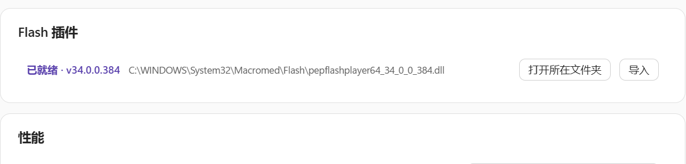

# Flash 插件自动发现：用户不用先手工导入

2026-11-24 · 起因：BYOP 要求用户自己找 `pepflashplayer64.dll` 再导入。但真实机器上插件
往往**本来就在**——flash.cn 把它装进 `C:\Windows\System32\Macromed\Flash`，旧版
Chrome/Chromium 用组件更新放在 `<User Data>\PepperFlash\<版本>\`，国产双核浏览器也各带一份。
让用户从这些目录里挑一个 16 MB 的 DLL 再复制一遍，是可以省掉的步骤。

## 1. 改法：解析顺序加一档「自动发现」

| # | 位置 | 来源标签 | 由谁提供 |
| --- | --- | --- | --- |
| 1 | `BAO_FLASH_PLUGIN` 环境变量 | `env` | 显式覆盖（验收/调试） |
| 2 | `<userData>\flash\pepflashplayer64.dll` | `user` | 设置页「导入」 |
| 3 | `<exe目录>\flash\pepflashplayer64.dll` | `exe` | 手工投放 |
| 4 | `<exe目录>\pepflashplayer64.dll` | `exe` | 随内核 dist 进入产物 |
| 5 | `<resources>\pepflashplayer64.dll` | `resources` | 旧打包布局 |
| 6 | **本机常见安装位置** | `scan` | 自动发现（新增） |

**1–5 任意一档存在就不会走到 6**：用户需要指定版本时仍然用「导入」，导入的那份必须优先，
不能被机器上另一份更新/更旧的插件顶掉。

设置页那一行只显示**路径**（过长时省略号截断），不再区分「应用目录 / 自动发现」——路径本身
已经把来源说清楚了。按钮是「打开所在文件夹」与「导入」。

一开始还放了「重新扫描」按钮，后来去掉了：插件注册在启动命令行里，进程内改不了，它点完只能
把状态文字刷新成「重启后生效」，而重启本来就会重扫；用户很容易把它当成「重新加载」。改成了
定位文件管理器——那才是这一行真正需要的手动动作。没找到插件时该按钮置灰（此时 `path` 只是
建议的投放位置）。

实现拆成四个不 import electron 的模块，便于单测：

| 文件 | 职责 |
| --- | --- |
| `src/main/flash-roots.ts` | 按平台列出候选目录（Windows 系统 Macromed / 各浏览器 PepperFlash / 下载 / 桌面；Linux 的发行版包；macOS 的 Internet Plug-Ins） |
| `src/main/flash-scan.ts` | 有界扫描：深度 + 条目数 + 时间预算三道闸；按文件名/目录名里的版本从新到旧排，逐个校验，第一个通过即结果 |
| `src/main/plugin-file.ts` | 平台相关校验：Windows 复用 PE 导出表解析；POSIX 用 ELF/Mach-O 魔数 + 位宽 + `PPP_GetInterface` |
| `src/main/flash-discovery.ts` | 编排 + 缓存（`<userData>\flash\discovery.json`）+ `BAO_FLASH_DISCOVERY=off` 开关 |

关键取舍：

- **必须同步**。插件是在 `app.ready` 之前用 `--register-pepper-plugins` 注册的，异步扫描只能
  等到下次启动才生效——那等于「装上后还要再重启一次」。
- **必须有界**。同步扫描在启动路径上，因此每道闸都取小：目录深度 ≤4、条目 ≤20000、时间预算
  400 ms；预算用完保留已找到的结果，只打一行日志。不跟符号链接/联接点，避免目录环。
- **必须先校验**。文件名命中只是候选：Chrome 的组件式 Flash 在 32 位 Chrome 下是
  `pepflashplayer.dll`（32 位），系统里也可能有同名假文件。只有「64 位 + 导出
  `PPP_GetInterface`」才会被注册（沿用审计 P2 的 `pe-plugin.ts`）。
- **缓存只判「路径还在 ∧ 大小没变」**。重扫一次要读 16–30 MB 的文件，缓存的全部意义就是省掉
  这次读；换插件本来就要重启才生效。
- **状态改为比较路径**。原来 `ready` 只看「启动时是否注册成功」，用户导入新版本后仍显示
  「已就绪」。现在比较「启动时注册的路径」与「当前解析到的路径」，不一致就是
  `restartRequired`——自动发现让这种不一致第一次变得常见（启动时用掉发现的那份，之后又导入）。

## 2. 实测

| 场景 | 结果 |
| --- | --- |
| 本机（装有 flash.cn 的 `pepflashplayer64_34_0_0_384.dll`）首次扫描 | 27 ms 找到，版本 `34.0.0.384` |
| 同一次启动内第二次读取（命中缓存） | 1 ms |
| 把运行时复制到临时目录、**删掉** exe 同级的 `pepflashplayer64.dll` 后跑 `flash.test.cjs` | ✅ 自动发现系统 Flash 34 并注册；Pepper Plugin 进程起来、`flash:loaded bridge`、插件进程 `sandboxed: true` |
| 有 exe 同级插件 + 本机也有系统 Flash（`flash.test.cjs` 新用例） | ✅ 仍加载投放的那份 `29.0.0.171`，`source` 不是 `scan` |
| 整套应用冒烟（`npm run smoke`，19 个文件） | ✅ 0 失败 |

单元层新增 29 条（`flash-roots` / `flash-scan` / `plugin-file` / `flash-discovery`），覆盖版本
解析、深度与预算、候选顺序、校验上限、缓存命中与失效、开关取值。

设置页的效果（运行时里**没有** exe 同级插件，自动发现拿到系统 Flash 34）：

## 3. 边界与后续

- **不复制、不移动**用户已有的插件：只记住路径。卸载 Flash 后缓存失效，下次启动重扫并停用。
- **32 位插件会被跳过**（校验不通过），不会出现「显示已就绪但加载失败」。若机器上只有 32 位
  Flash，设置页显示「未找到」，仍可用「导入」指定别的文件。
- **只挑第一个可用且版本最新的**：不做「多版本并存 + 按站点选版本」。需要钉版本时用「导入」，
  导入的那份优先级最高。
- **`BAO_FLASH_DISCOVERY=off`** 是给成品冒烟用的（public 包要断言「产物里没有插件」，不能被这台
  机器装的系统 Flash 干扰），也顺带给了不想扫盘的用户一个开关；没有做成设置项，因为扫描发生在
  存储初始化之前（注册命令行早于 `initStorage()`），做设置项要额外解决启动顺序。
- 非 Windows 的候选目录只是一份清单，**没有产物验证**——当前只有 Win x64 打包，POSIX 的
  ELF/Mach-O 判断仅保证不会误加载 32 位库。
