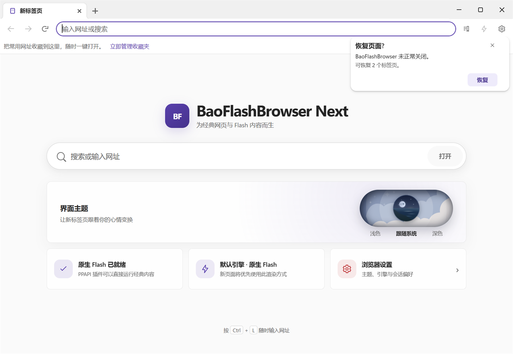

# M2 增量：崩溃恢复气泡（对齐 Chromium 的「恢复页面」警示对话框）

2026-11-26 · 承接 [2026-11-24 会话恢复](2026-11-24-session-restore.md)（其 §2「提示形态」
一条被本文推翻，其余条款继续有效）。代码：`app/src/shared/overlay.ts`、`app/src/main/shell-overlays.ts`、
`app/src/main/browser-window.ts`、`app/src/renderer/OverlayHost.vue`、`app/src/renderer/SessionRestoreBubble.vue`、
`app/src/renderer/App.vue`。

## 1. 结论

| 项 | 11-24 版 | 本增量 |
| --- | --- | --- |
| 形态 | 外壳顶部**全宽提示条**（infobar，`INFOBAR_HEIGHT = 36`） | **警示气泡**（叠加层视图内的卡片） |
| 位置 | `<header>` 里、收藏夹横条下方，占 36px 布局高度 | 工具栏最右那颗按钮（齿轮）下方，浮在页面之上，**不占布局** |
| 动作 | 「恢复标签页」+「忽略」两个文字按钮 | 主按钮「恢复」+ 右上角 ×（= 忽略），Enter / Esc 可用 |
| 文案 | 「上次未正常退出，可以恢复 N 个标签页」 | 标题「恢复页面?」+「BaoFlashBrowser 未正常关闭。」+「可恢复 N 个标签页。」 |
| 点外面 | 不存在这个概念 | **不关**（警示对话框，Chromium 的 `DisableCloseOnDeactivate`） |
| 语义 | 用户确认才恢复；未回答前挂起写盘；未回答就退出 → 下次继续问 | **完全不变** |

产品侧动因只有一句：**Chrome / Edge 都是气泡，我们是条**——而代码注释从 11-24 起就自称
"Chrome 的「恢复页面」气泡"（`shared/browser.ts`、`App.vue` 两处），名与形不一致。

前台实测（自编译 E39 / 142.0.7444.265，硬杀后重启）：

## 2. 推翻 11-24 的决策（原文与理由）

[11-24 报告 §2](../reports/2026-11-24-session-restore.md) 当时写：

> 「外壳 DOM 被页面 WebContentsView 覆盖，弹窗式浮层会看不见；infobar 在 chrome 区天然可见，
> 且 Playwright 可断言」

这条在 11-24 是成立的（当时飞窗还没做成独立叠加层视图），但**到 11-26 已经过期**：

- 叠加层视图（`main/shell-overlays.ts`）从 11-23 起就是独立 `WebContentsView`，11-25 收敛成
  「一个常驻文档 + 一个渲染进程」，11-26 补上投影边距与边距鼠标转发。齿轮飞窗、收藏夹面板、
  编辑气泡都靠它稳定画在**页面之上**（证据：[flyout-bubble.png](../evidence/2026-11-26-flyout-bubble.png)）。
- 于是"气泡会被页面压住"不再成立；"Playwright 可断言"也不成立为障碍——叠加层文档同样能用
  `webContents.executeJavaScript` 定位（见 §6 的 `helpers.cjs`）。

## 3. Chromium 142 源码依据

本机检出 `D:\electron-build-142\cr\src` = **142.0.7444.265**（与本项目内核同版本），逐项对照：

| 事实 | 依据 |
| --- | --- |
| 崩溃恢复是**气泡**，不是 infobar | `chrome/browser/ui/views/session_crashed_bubble_view.cc:219-278`：`BubbleDialogModelHost` + `BubbleBorder::TOP_RIGHT` |
| 锚点 = 工具栏**最右那颗**按钮 | 同文件 `browser_view->toolbar_button_provider()->GetAppMenuButton()`（Chrome 是应用菜单 ⋮） |
| 警示对话框语义 | `SetIsAlertDialog()` + `DisableCloseOnDeactivate()`：失焦不关，必须回答 |
| 文案 | 标题 `IDS_SESSION_CRASHED_BUBBLE_TITLE` =「Restore pages?」（`chrome/app/generated_resources.grd`）；正文 `IDS_SESSION_CRASHED_VIEW_MESSAGE` =「Chrome didn't shut down correctly.」（`components/components_google_chrome_strings.grd`）；主按钮 `IDS_SESSION_CRASHED_VIEW_RESTORE_BUTTON` =「Restore」（`components/components_strings.grd`） |
| 默认只有一个主按钮 | `AddCancelButton` 只在启动页模板非空时才加（动作是"打开启动页"），我们没有那个模式，故不出现 |
| 崩溃时**绝不自动恢复**（防崩溃循环） | `chrome/browser/ui/startup/startup_browser_creator_impl.cc:611-614` 注释：`this codepath is not hit by crash restore ... Crash restores are triggered via session_crashed_bubble_view.cc` |
| 只在「上次没干净退出」时出现 | `chrome/browser/ui/startup/infobar_utils.cc:154-159`：`HasPendingUncleanExit(profile)` + 非 Web App + 非无痕 |
| 关闭气泡 = 已确认；不回话就退出 = 下次再问 | `chrome/browser/sessions/exit_type_service.cc:114-128,194-241`：`CrashedLock` 随气泡销毁释放 → `CheckUserAckedCrash()`；`~ExitTypeService` 在 `waiting_for_user_to_ack_crash_` 时不写 `Clean` |

**一个容易踩的坑**：`chrome/browser/ui/views/session_restore_infobar/`（2025 新增）**不是**这件事。
它是提醒用户开/关「继续上次会话」的**设置引导条**。只看目录名会得出"Chromium 也用 infobar"的错误结论。

气泡本身也不年轻：`git log --follow` 上最早提交是 2014-04-30（`Show bubble to prompt UMA opt-in on crash recovery`），
即 Chrome 用气泡已经十来年。

## 4. 我们的实现

### 4.1 载体：叠加层新增第四种内容角色 `bubble`

`OverlayKind = 'panel' | 'quick' | 'toast' | 'bubble'`。为什么单独成一种而不是塞进
`QuickView`（快捷设置/收藏夹那套"飞窗换页"）：

- **语义不同**：飞窗是用户主动打开、点外面就收的面板；气泡是启动时自动出现、必须回答的警示框。
- **共享载体不共享语义**：同一个视图、同一个渲染进程（共享进程模式下就是外壳的进程），
  所以**不新增进程、不新增 WebContents、零常驻内存增量**——对比"给气泡单开一个
  `WebContentsView`"独立渲染进程 +114 MB（[11-25 overlay 实测 §5.1](../discussions/2026-11-25-overlay-shared-process-demo.md#L63-L73)）。

接线（全部走已有的叠加层通道，不新增 IPC 通道）：

| 方向 | 内容 |
| --- | --- |
| shell → main | `set-bubble`（bounds + tabs；`bounds=null` 收起）、`resize-bubble`（气泡上报卡片高度） |
| bubble → main | `close-bubble{restore}`（唯一回答入口） |
| main → shell | `bubble-opened{theme,tabs}`、`bubble-closed` |

### 4.2 行为

| 场景 | 行为 |
| --- | --- |
| 启动时存在崩溃会话 | 投影里 `sessionPrompt` 出现 → 外壳算锚点 → `set-bubble` → 气泡出现在齿轮下方，焦点在「恢复」 |
| 点「恢复」/ Enter | `close-bubble{restore:true}` → 主进程 `restoreCrashSession()`（与命令通道 `restore-session` 同一函数） |
| 点 × / Esc | `close-bubble{restore:false}` → `dismissCrashSession()` |
| 点卡片外面 / 窗口失焦 | **不关**（警示对话框）；边距里的鼠标转给页面，不会"点了没反应" |
| 点齿轮打开飞窗 | 气泡让位，并按 Chromium 的「关闭即已确认」丢弃会话（新增用例覆盖） |
| 会话被清除（设置 → 数据） | `forgetSessionPrompt()` → `hideBubble()`，气泡消失且不当作回答 |
| 窗口缩放 | 气泡跟着锚点重算位置（不关、不重置焦点） |
| 用户不回答就退出 | 与 11-24 相同：退出标记写 `pending`，下次启动继续问 |

### 4.3 布局

`browser-window.ts` 的 `layout()` 删掉了 36px 的 `INFOBAR_HEIGHT` 偏移，页面视图的 `y`
只由 标签栏(40) + 工具栏(44) [+ 收藏夹横条(32)] 决定。`INFOBAR_HEIGHT` 常量随之删除
（全仓库只有这条提示用它；不为"以后可能还有 infobar"留空壳）。

## 5. 与 Chromium 的两处刻意差异

1. **正文多一行标签数**（「可恢复 N 个标签页。」）：Chromium 只说"没正常关闭"。我们的会话是
   跨窗口并回（上限 10 窗口 / 200 标签），标签数是用户判断"值不值得恢复"的唯一依据。
2. **× 带 `title="忽略（不恢复）"`**：中文环境里光一个 × 容易被读成"稍后再说"，而它的实际语义是
   "丢弃这份会话"。

不照搬的部分：UMA 勾选项（我们不做遥测）、「打开启动页」次要按钮（我们没有启动页模板）、
锚到应用菜单（我们最右是齿轮）。

## 6. 验证

| 命令 | 结果 |
| --- | --- |
| `npm run typecheck` | ✅ |
| `node scripts/test.cjs unit` | ✅ 27 文件 / **358 通过** |
| `node scripts/test.cjs data` | ✅ 2 文件 / **11 通过** |
| `node scripts/test.cjs smoke --only=session-restore` | ✅ **8 条用例全通过**（约 33 s） |
| `node scripts/test.cjs smoke`（全量） | ✅ **31 个文件 / 0 失败**（106.8 s，4 并发）；`newtab` 在并行负载下出过一次 `Cannot find context with specified id`，单独重跑 7/7 通过（与 11-25 记录的并行脆弱点同类，与本增量无关） |

`tests/smoke/session-restore.test.cjs` 的断言从外壳 DOM（`.session-infobar`）迁到叠加层文档：

- 新增 `helpers.cjs`：`overlayEval` / `sessionBubbleState` / `waitForSessionBubble` /
  `waitForSessionBubbleGone` / `clickSessionBubble` / `pageViewBounds`；
- 断言气泡的**标题/正文/主按钮文案**逐项对齐源码；
- 断言 `pageViewBounds().y ∈ {84, 116}`——提示条那版会多 36px，这条把"气泡不推页面"钉住；
- 新增用例「气泡显示时打开齿轮飞窗」：验证「被顶掉 = 已确认」不会把提示留成"没回答"。

`data/` 层（`session-store.test.cjs` 4 条）未改：`sessionPrompt` 投影与退出标记的语义没变。

## 7. 未覆盖与风险

1. **仍然只在第一个窗口显示**：多窗口会话并回当前窗口，窗口布局/位置不还原（11-24 起未变）。
2. **没有"稍后再说"**：Chromium 也没有；想要"总是恢复"的用户改 `session.startup=continue`。
3. **气泡被顶掉即丢弃会话**：这是照抄 Chromium 的 `CrashedLock` 语义。代价是"点齿轮顺手丢掉一份
   会话"，收益是提示不会在后台挂成"没回答"。数据本身在下次写盘前还在库里，只是不再提示。
4. **共享进程连坐**：气泡与外壳同进程（默认），外壳渲染进程崩溃会连带气泡；重载后外壳会按投影
   重新把气泡显示回来（`sessionPrompt` 仍在新进程的第一次快照里）。
5. **前台截图只有一处**：`docs/evidence/2026-11-26-session-bubble.png` 是浅色 + 新标签页背景下的
   实测图；深色主题、窄窗口夹取、多显示器尚未留图（几何走的是飞窗那套已测过的 `clampBelow`）。

## 8. 代码位置

| 内容 | 位置 |
| --- | --- |
| 气泡角色与通道 | `app/src/shared/overlay.ts`（`OverlayKind` / `set-bubble` / `resize-bubble` / `close-bubble` / `bubble-opened` / `bubble-closed`） |
| 视图与命中 | `app/src/main/shell-overlays.ts`（`answerBubble` / `item.tabs` / `hideBubble` / `bubbleVisible` / `set-bubble` 分支 / `showOverlay` 的顶掉语义） |
| 窗口接线 | `app/src/main/browser-window.ts`（`onBubbleAnswer` / `restoreCrashSession` / `dismissCrashSession` / `forgetSessionPrompt` / `layout`） |
| 气泡 UI | `app/src/renderer/SessionRestoreBubble.vue`、`app/src/renderer/OverlayHost.vue` |
| 外壳锚点与开关 | `app/src/renderer/App.vue`（`sessionBubbleBounds` / `openSessionBubble` / `closeSessionBubble` / `watch(sessionPrompt.tabs)`） |
| 预加载桥 | `app/src/preload/index.ts`（`setBubble` / `resizeBubble` / `closeBubble`） |
| 测试 | `app/tests/smoke/helpers.cjs`、`app/tests/smoke/session-restore.test.cjs`、`app/tests/smoke/data-cleanup.test.cjs` |
